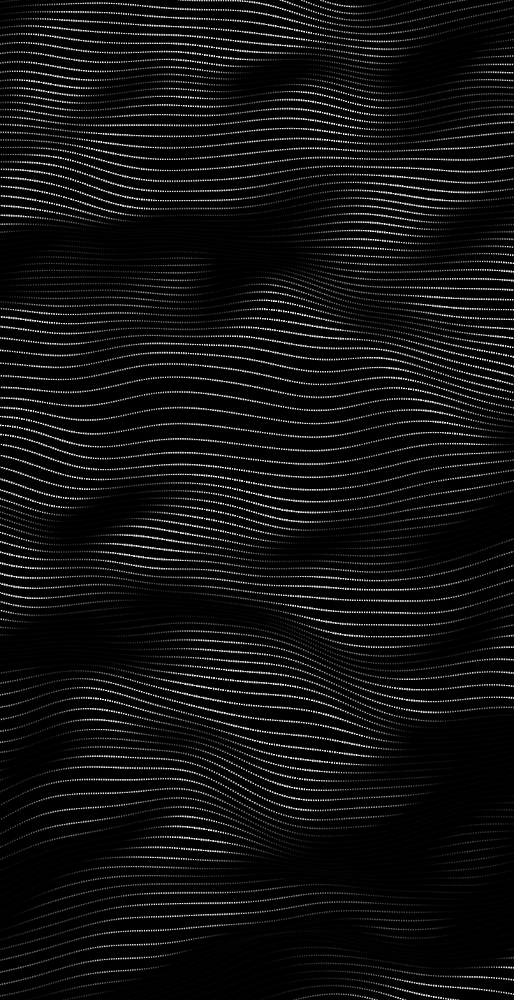
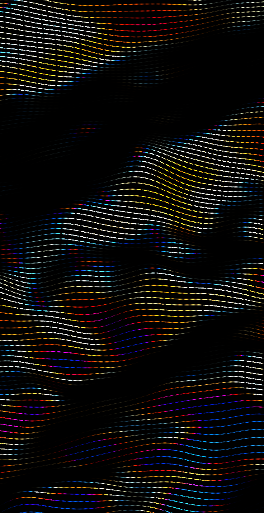
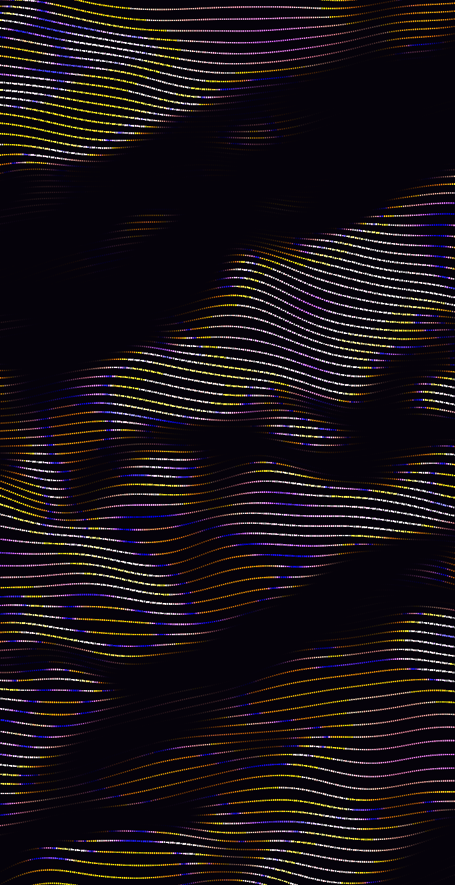
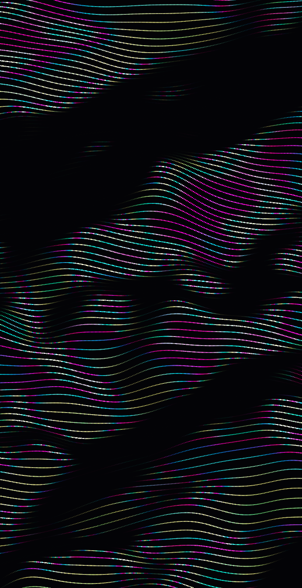

# Dotted Wave Mesh — Lazarus + BGRABitmap + OpenGL (vsync)

แอนิเมชันคลื่นเส้นจุดขาวดำ สร้างตามภาพอ้างอิง `../19829fdf8954334590777efdaefd1f65.png` (ผลวิเคราะห์อยู่ใน `../IMAGE_ANALYSIS.md`)

| Original | Iridescent Pearl | Holographic | Oil Slick |
|---|---|---|---|
|  |  |  |  |

---

## 1. Build & Run

| สิ่งที่ต้องมี | เวอร์ชันที่ทดสอบ |
|---|---|
| Lazarus | 3.x (FPC 3.2.2, Win64) |
| BGRABitmapPack | ติดตั้งผ่าน Online Package Manager |
| LazOpenGLContext | มากับ Lazarus (`components/opengl`) |

```bash
C:/lazarus/lazbuild.exe DottedWave.lpi
```

หรือเปิด `DottedWave.lpi` ใน Lazarus IDE แล้วกด F9 ไฟล์ที่ได้คือ `bin/DottedWave.exe`
มี 2 build mode: **Release** (-O3, smart link) และ **Debug** (range/overflow check, dwarf3)

### คำสั่งแบบไม่เปิดหน้าต่าง (headless / CI)
```bash
DottedWave.exe --export out.png 1080 2340 2.5 --config my.ini
```
```bash
DottedWave.exe --spec spec.json --pascal preset.inc --config my.ini
```
ลำดับอาร์กิวเมนต์ `--export` คือ `ไฟล์ [กว้าง สูง phase]` ทุกตัวเลือกใช้ `--config` ได้
และใช้ `--preset N` (0–7) เพื่อเริ่มจาก preset นั้น เช่น `--export holo.png --preset 6`

---

## 2. หน้าต่าง

| หน้าต่าง | หน้าที่ |
|---|---|
| **Main** (`TMainForm`) | แสดงแอนิเมชันเต็มพื้นที่ด้วย `TOpenGLControl` สัดส่วนเริ่มต้น 736:1431 |
| **Controls & Export** (`TControlForm`) | หน้าต่างแยก ไม่ modal มีทุกพารามิเตอร์ สี preset และเครื่องมือ Export |

### คีย์ลัด (หน้าต่าง Main)
| ปุ่ม | การทำงาน |
|---|---|
| `F1` / `Tab` / คลิกขวา | เปิด/ปิดหน้าต่าง Controls |
| `Space` | หยุด/เล่น |
| `F11` / `Esc` | เข้า/ออกเต็มจอ |
| `V` | เปิด/ปิด VSync |
| `F` | เปิด/ปิด FPS overlay |
| `R` | รีเซ็ต phase เป็น 0 |
| `Ctrl+S` | Export PNG ขนาด 736×1431 ไปที่ `bin/exports/` ทันที |
| คลิกซ้ายค้าง/ลาก | สร้างคลื่นกระเพื่อม (ripple) |

ค่าที่ตั้งไว้จะบันทึกลง `bin/dottedwave.ini` อัตโนมัติเมื่อปิดโปรแกรม และโหลดกลับมาตอนเปิดครั้งถัดไป

---

## 3. Export (หน้าต่าง Controls)

| ปุ่ม | ผลลัพธ์ |
|---|---|
| **Export PNG** | ภาพนิ่งตามขนาด W×H ที่ตั้งไว้ (มี preset: Original, @2x, Phone, FHD, 4K, Square) |
| **PNG Sequence** | `frame_00000.png …` + `sequence.json` (มีคำสั่ง ffmpeg ทำเป็น mp4) + `config.json` กด Cancel ได้ระหว่างทำ |
| **Save .ini / Load .ini** | บันทึกหรือโหลด preset |
| **JSON spec** | สเปก UI ครบทุกพารามิเตอร์ ได้แก่ value, default, min, max, group, label, description |
| **Pascal .inc** | `procedure ApplyWavePreset(var C: TWaveConfig)` ใช้กับ `{$I}` ได้ทันที |
| **Copy JSON** | คัดลอกสเปกไปยัง clipboard |
| **Export Dev Pack** | โฟลเดอร์ที่มี PNG 3 ขนาด + `config.ini` + `spec.json` + `preset.inc` + `README.md` |

ผลการ export ไม่ขึ้นกับความละเอียด เพราะทุกค่าความยาวใช้หน่วย **px อ้างอิง** ของแคนวาส 736×1431
และคูณด้วย `scale = targetHeight / 1431` ตอน render

---

## 4. สถาปัตยกรรม

```
DottedWave.lpr          entry + headless CLI
src/
  usimplexnoise.pas     3D simplex noise (seedable)
  uwavetypes.pas        TWaveParam / ParamDefs (metadata ทุกพารามิเตอร์), presets, INI/JSON/Pascal I/O
  uwaveengine.pas       TWaveEngine.Render(TBGRABitmap, Config, Phase, RealTime)  ← CPU renderer
  uplatform.pas         NowSeconds (QPC), SetSwapInterval (wglSwapIntervalEXT)
  umainform.pas         TOpenGLControl + TBGLBitmap → BGLCanvas, idle loop, input
  ucontrolform.pas      UI สร้างจาก ParamDefs อัตโนมัติ + export
```

### ลำดับการทำงานต่อเฟรม
1. `Application.OnIdle` เรียก `FGL.Invalidate`
2. `GLPaint` คำนวณ dt ด้วย QueryPerformanceCounter แล้วบวก `Phase += dt × speed`
3. `TWaveEngine.Render` วาดลง `TBGLBitmap` (ขนาด = หน้าต่าง × renderScale)
   1. **Height field**: fBm simplex บนกริด (เส้น × จุด) โดยใช้ `noise(x·ns·stretchX + drift, y·ns, phase)`
   2. **Displace**: `y += h · amplitude · depthK` (perspective tilt) และ `x += warp · noise₂`
   3. **Normal** จาก finite difference ของกริด (ไม่ต้องคำนวณ noise ซ้ำ)
   4. **แสง**: `I = exposure · (ambient + diffuse·max(0,N·L) + specular·(N·H)^power)` แล้ว `I = I^contrast`
   5. **Splat**: วาดจุดสี่เหลี่ยมแบบ box-filter coverage + additive ลง float buffer (ขยับแบบ sub-pixel ได้เนียน)
   6. **Colorize**
      - โหมดขาวดำ (`iriAmount = 0`): `bg + (dot − bg) · min(1, acc · vignette)` ใช้บัฟเฟอร์ช่องเดียว
      - โหมด Iridescent (`iriAmount > 0`): สะสม R,G,B แยกช่อง แล้วคำนวณ `bg·(1−a) + rgb / max(1, acc)`
4. `BGLCanvas.PutImage` / `StretchPutImage` แล้ว `SwapBuffers`
5. **VSync**: เรียก `wglSwapIntervalEXT(1)` ครั้งแรกที่มี context ทำให้ `SwapBuffers` รอ vblank และ loop เดินตาม refresh rate ของจอ

### Multi-threading
- `TWaveEngine` ใช้ thread pool ถาวร มี worker เท่ากับจำนวน CPU core ลบ 1 (สูงสุด 16) และปลุกด้วย RTL event จึงไม่มีค่าใช้จ่ายสร้างเธรดทุกเฟรม
- ขั้นตอน Height field, แสง/สี และ Colorize แบ่งงานตามแถว ส่วนขั้นตอน Splat ทำในเธรดหลัก (เร็วอยู่แล้ว)
- ตั้ง `Engine.Threads := 1` ก่อน render ครั้งแรกถ้าต้องการให้ทำงานเธรดเดียว
- ผลลัพธ์เหมือนเวอร์ชันเธรดเดียวทุกพิกเซล (ตรวจด้วยการเทียบไฟล์ PNG) และเวลา render ลดจาก 14.2 ms เหลือประมาณ 3 ms บนเครื่อง 12 thread

### Hooks สำหรับเกม / interaction (ใช้ใน [WaveRider](../WaveRider/README.md))
| Field | ความหมาย |
|---|---|
| `ScrollY` | เลื่อนผิว noise ลงตามแกน Y (หน่วย px อ้างอิง) |
| `Wells: array of TWaveWell` | เนินหรือหลุมแบบ gaussian (`Height`) และการกลืนหรือเพิ่มแสง (`Darken`) |
| `Rings: array of TWaveRing` | คลื่นวงแหวนที่รัศมี `R` |
| `FieldWidth` | ความกว้างแคนวาสหน่วย px อ้างอิงของเฟรมล่าสุด |

### การเพิ่มพารามิเตอร์ใหม่
1. เพิ่มค่าใน enum `TWaveParam`
2. เพิ่มแถวใน `ParamDefs` (key, caption, group, min, max, default, decimals, hint)
3. ใช้ `V[wpXxx]` ใน `TWaveEngine.Render`

UI slider, INI, JSON, Pascal export และ Dev Pack README จะรองรับพารามิเตอร์ใหม่โดยอัตโนมัติ

---

## 5. สี Iridescent (ประกายรุ้งแบบมุก/ฟิล์มบาง)

เฉดสีของแต่ละจุดคำนวณแบบ thin-film interference อย่างง่าย:

```
t   = iriFrequency · sinθ            (มุมเอียงของผิว จาก normal)
    + iriHeight    · h               (ความสูงของคลื่น)
    + iriSpread    · (0.6·x/W + y/H) (ไล่ตามตำแหน่งแนวทแยง)
    + iriSpeed     · phase + iriOffset
col = palette(frac(t))                LUT 256 สี สร้างใหม่ทุกเฟรม
col = mix(dotColor, col, iriAmount)
col = mix(col, white, iriSpecWhite · specular/total)   ประกายบนสันคลื่นเป็นสีขาว
```

Palette เป็น cosine palette `0.5 + 0.5·cos(2π(c·t + d))` แล้วปรับความอิ่มสี (`iriSaturation`) และ normalize ให้ช่องสีที่สว่างที่สุดเท่ากับ 1 จุดจึงยังสว่างเต็มที่

| `iriPalette` | ชื่อ | c | d |
|---|---|---|---|
| 0 | Rainbow | (1, 1, 1) | (0, .33, .67) |
| 1 | Pearl | (1, 1, 1) | (0, .10, .20) |
| 2 | Oil slick | (2, 1, 0) | (.5, .20, .25) |
| 3 | Holographic | (1, .7, .4) | (0, .15, .20) |
| 4 | Beetle | (1, 1, .5) | (.8, .90, .30) |

เพิ่ม palette ใหม่ได้ที่ `IriC` / `IriD` ใน `uwaveengine.pas` แล้วขยาย `MaxV` ของ `iriPalette`
ค่า phase ใช้แทนเวลาจริง ทำให้ PNG Sequence วนสีได้ตรงกับในหน้าต่าง

## 6. พารามิเตอร์ (ค่าเริ่มต้นคือ preset "Original")

| Group | Key | Default | Range | ความหมาย |
|---|---|---|---|---|
| geometry | `lines` | 120 | 20–300 | จำนวนเส้นแนวนอน |
| geometry | `dotSpacing` | 3.4 | 1.5–12 | ระยะห่างจุดตามแนวเส้น |
| geometry | `dotSize` | 1.9 | 0.5–6 | ขนาดจุดสี่เหลี่ยม |
| geometry | `amplitude` | 115 | 0–250 | ระยะการยกตัวของคลื่น |
| geometry | `noiseScale` | 0.0017 | 0.0003–0.01 | ความถี่ noise |
| geometry | `octaves` | 3 | 1–6 | จำนวนชั้น fBm |
| geometry | `lacunarity` | 2.0 | 1.2–3.5 | ตัวคูณความถี่ต่อ octave |
| geometry | `gain` | 0.45 | 0.1–0.9 | ตัวคูณแอมพลิจูดต่อ octave |
| geometry | `stretchX` | 0.55 | 0.1–2 | ยืดลอนตามแนวนอน |
| geometry | `warp` | 18 | 0–80 | บิดแนวนอน สร้างจุดบีบ |
| geometry | `tilt` | 0.15 | 0–0.6 | มุมมองเอียง |
| motion | `speed` | 0.12 | 0–2 | ความเร็ว (phase ต่อวินาที) |
| motion | `driftX` / `driftY` | 0.6 / 0.25 | −3–3 | ทิศการไหลของคลื่น |
| light | `lightAzimuth` | 225° | 0–360 | ทิศแสง (ซ้ายบน) |
| light | `lightElevation` | 32° | 2–89 | มุมเงยของแสง |
| light | `relief` | 2.6 | 0–10 | ขยายความชันสำหรับคำนวณแสง |
| light | `ambient` | 0.07 | 0–1 | แสงพื้นฐาน |
| light | `diffuse` | 1.0 | 0–2 | Lambert |
| light | `specular` / `specPower` | 0.6 / 20 | 0–2 / 1–128 | ประกาย Blinn-Phong |
| light | `exposure` | 1.45 | 0.1–4 | ความสว่างรวม |
| light | `contrast` | 1.5 | 0.3–5 | gamma ของความสว่าง |
| color | `vignette` | 0.25 | 0–1.5 | ขอบภาพมืดลง |
| color | Background / Dots | `#000000` / `#F2F2F2` | — | สีพื้นและสีจุด |
| color | `iriAmount` | 0 | 0–1 | ผสมสี Iridescent (0 = ขาวดำ) |
| color | `iriPalette` | 1 | 0–4 | ชุดสี (ดูตารางข้อ 5) |
| color | `iriFrequency` | 1.2 | 0–10 | จำนวนแถบสีตามมุมเอียงของผิว |
| color | `iriHeight` | 0.4 | 0–4 | เปลี่ยนสีตามความสูงคลื่น |
| color | `iriSpread` | 0.5 | 0–4 | ไล่สีตามตำแหน่งบนจอ |
| color | `iriSpeed` | 1.0 | 0–10 | ความเร็วหมุนเฉดสี (ต่อ phase) |
| color | `iriOffset` | 0 | 0–1 | เลื่อนเฉดสีทั้งชุด |
| color | `iriSaturation` | 1.2 | 0–1.5 | ความอิ่มสี |
| color | `iriSpecWhite` | 0.35 | 0–1 | ประกาย specular เป็นสีขาว |
| interaction | `rippleStrength` / `rippleRadius` | 0.9 / 160 | — | คลื่นกระเพื่อมจากเมาส์ |
| render | `renderScale` | 1.0 | 0.25–2 | ความละเอียดภายใน |
| render | `seed` | 7 | 0–9999 | ค่าสุ่มของ noise |

Presets (0–7): Original, Calm Silk, Storm, Dense Fabric, Sound Wave, **Iridescent Pearl**, **Holographic**, **Oil Slick**

---

## 7. ประสิทธิภาพ (วัดจริงบนเครื่องพัฒนา)
- หน้าต่าง 463×900: ประมาณ 36k จุด, render ประมาณ 10.5 ms/เฟรม (ขาวดำ), ประมาณ 13 ms/เฟรม (Iridescent), **60 fps (vsync on)**
- ถ้าหน้าต่างใหญ่หรือเต็มจอแล้ว fps ตก ให้ลด `renderScale` ลงเหลือ 0.5–0.75 หรือลด `lines` / เพิ่ม `dotSpacing`

## 8. แนวทางพัฒนาต่อ
- ย้ายขั้นตอน displacement และแสงไปทำใน GLSL vertex shader (`TBGLShader3D`) เพื่อให้รับจำนวนจุดได้มากระดับ 1M
- แบ่งงานแถวให้หลายเธรด (`TThread` / MTProcs) ในขั้นตอนที่ 1 และ 5
- รองรับ vsync บน Linux (`glXSwapIntervalEXT`) ดู TODO ใน `uplatform.pas`
- ใช้ Audio input เป็นตัวขับ `amplitude` และ `rippleStrength` เพื่อทำ visualizer
