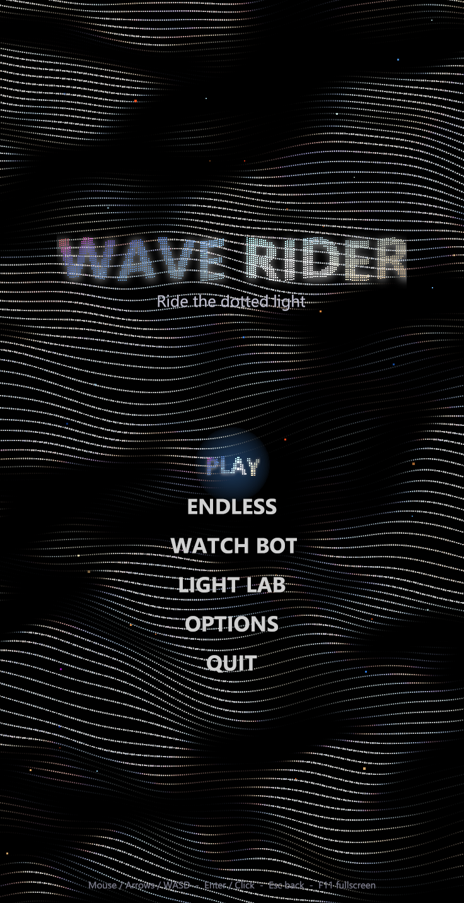
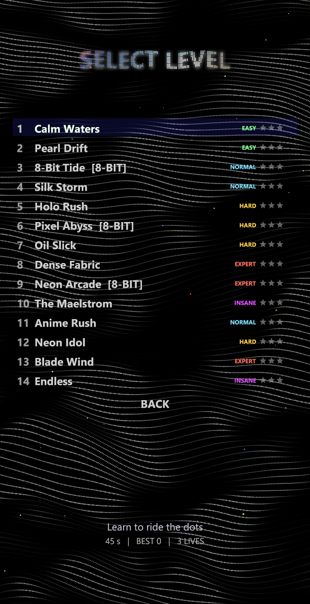
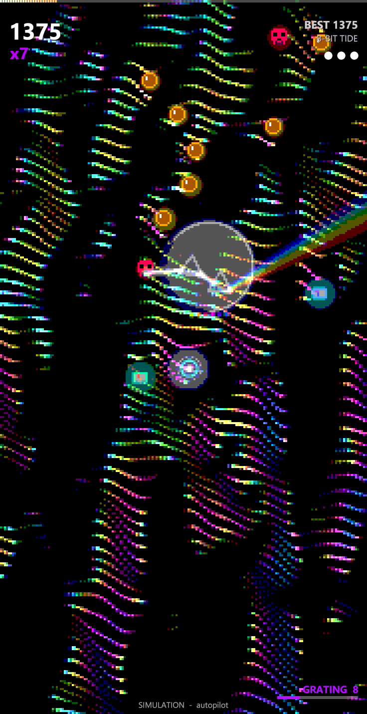
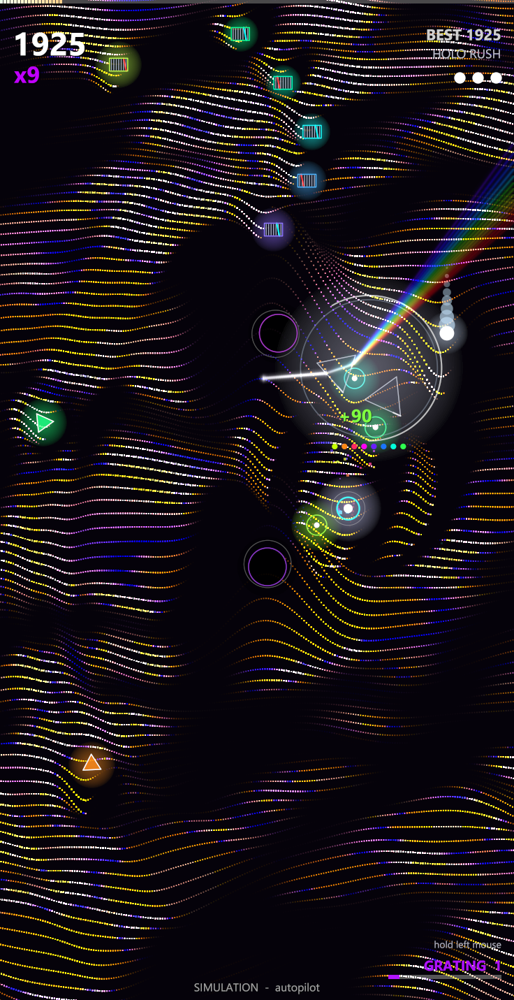
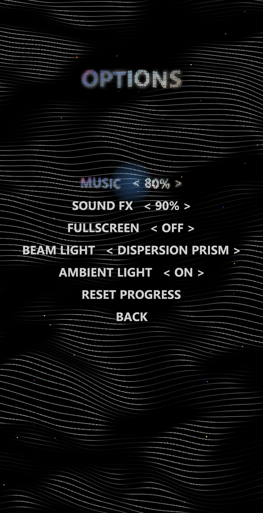
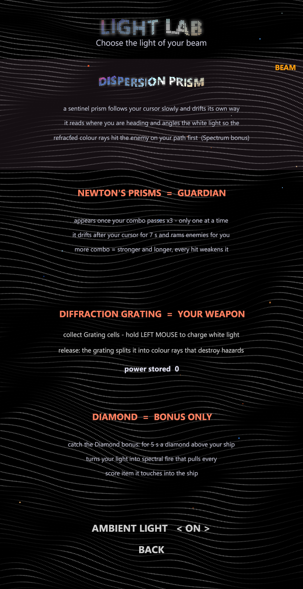
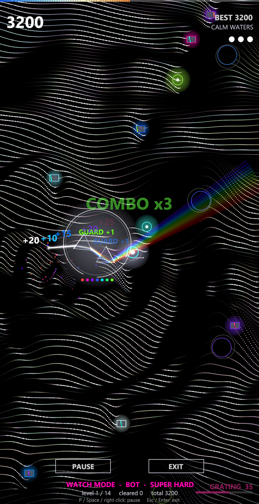

# WAVE RIDER + WaveRider Studio

A heavy-bass arcade game on the Dotted Wave Mesh engine (Lazarus, BGRABitmap, OpenGL + vsync),
plus a studio with five editors that change the game without touching code.

| Main menu | Level select | Pearl Drift | 8-Bit Tide (pixel) | Holo Rush |
|---|---|---|---|---|
|  |  |  |  |  |

| Ready | Pause | Level clear | Game over | Options |
|---|---|---|---|---|
|  |  |  |  |  |

| Light lab | Light Beam bonus |
|---|---|
|  |  |

---

## Build

```bash
C:/lazarus/lazbuild.exe WaveRider.lpi
```
```bash
C:/lazarus/lazbuild.exe studio/WaveRiderStudio.lpi
```

Both executables are written to `bin/`. Required packages: **BGRABitmapPack**, **LazOpenGLContext** (game only).
Audio uses the Windows `waveOut` API through FPC's `mmsystem` unit: no external DLL.
The engine units are shared from `../DottedWave/src`.

## Folders

```
bin/            WaveRider.exe, WaveRiderStudio.exe, waverider.ini (progress + options)
data/           objects.ini levels.ini screens.ini sfx.ini music.ini light.ini, anime/ (your images)  <- everything editable
src/            game + shared units
studio/src/     editors
tools/          audiotest (renders SFX + music to WAV, prints loudness / bass share)
```

If `data/` is empty, the game or the Studio writes the built-in defaults on first start.

---

## The game

| | |
|---|---|
| **Collect** | Spark, Prism, Coin: score x combo. Combo (max x9) turns the dotted mesh iridescent and drives the music |
| **Avoid** | Void (pit), Seeker (homing), Comet (fast), Twin (orbiting pair), Glitch (pixel zig-zag) |
| **Bonuses** | Pulse (clear hazards), Shield, Magnet, Slow-Mo, Double score, 1-Up, Star, Fever (max combo + music fever), Nova |
| **Levels** | 13 levels from Easy to Insane (including 3 chibi anime levels), plus Endless. Styles: Original, Pearl, Holographic, Oil Slick, Silk, Storm, Dense Fabric; pixel-art levels are 8-Bit Tide, Pixel Abyss and Neon Arcade |
| **Stars** | 1-3 stars per level from score thresholds. Clearing a level unlocks the next |

**Pause → MAIN MENU** keeps the run. The main menu then shows **CONTINUE**, which resumes with a 3-2-1 countdown.

Menus work fully with the mouse: hover highlights an item and shows a hand cursor; click selects it.
On value items (MUSIC, SOUND FX, BEAM LIGHT), clicking the left half decreases the value and the right half increases it.
Right-click = back. The cursor is hidden only while you are playing.

Controls: mouse / arrows / WASD to move, Enter / Space / click to confirm, Esc / P to pause or go back,
right-click to go back. F11 = fullscreen, F3 = fps / audio info, F5 = reload `data/` (after saving in the Studio).

Headless screenshots (used for these docs):
```bash
bin/WaveRider.exe --shot out.png 12 play 2
```
The arguments are `file [seconds] [mode] [level]`. Modes: `menu levels options light ready play beam watch pause over complete object`.

### Sound and music (all synthesized)

- **One synth voice** for SFX and instruments:
  - polyBLEP sine/saw/square/triangle/noise with detune and a sub oscillator;
  - 808 pitch envelope, slide, vibrato, arpeggio;
  - TPT state-variable filter (LP/HP/BP) with envelope and tempo-synced LFO wobble;
  - drive, bit-crush / sample-hold, ADSR.
- **SFX = 2 layers**: A is the character, B is the sub / kick thump. The default bank has 22 sounds.
  Most have 55-70 % of their energy below 120 Hz (measured by `tools/audiotest`).
- **Song "Pearl Pressure"**: 140 BPM, 8 tracks, 6 patterns, 9 sections, about 5 minutes, looping.
  It runs Intro, Build, Drop A, Break, Build 2, Drop B (half-time wobble), Break 2, Drop A2, Outro, with chord progressions per repeat.
- **The music reacts to the game**:

| Game event | Music effect |
|---|---|
| Combo rising | Growl bass / arp / lead layers fade in; master and per-track filters open; sidechain pumping deepens |
| Combo ≥ 6 | Wobble LFO doubles |
| Bonus pickup | Filter sweep + dotted-8th echo throw (`MusicSweep` per object) |
| Fever | 16th trance gate + more drive + echo |
| Slow-Mo | Tape slow-down (tempo and pitch x0.82) |
| Pause | Low-pass muffle + volume dip |
| Level start | Jumps to the level's music section |

### Anime levels (chibi)

Three levels sit before Endless: **Anime Rush** (Party: all four take turns), **Neon Idol** (Neko), **Blade Wind** (Ao).

**Original chibi characters** (`src/uanime.pas`, drawn with code). The head is about 60 % of the height, with tiny bodies and big expressions:

| | |
|---|---|
| **Mimi** | Purple cat girl, star hair clip, spiral blush, round ring eyes, `:3` mouth |
| **Kuma** | Girl in a bear hood, waves a bear paw, `^ ^` eyes, big laugh |
| **Neko** | Black-haired cat girl, bow, sparkly eyes, a little fang |
| **Ao** | Long blue hair with an ahoge, wink and peace sign |

**Chibi moments that come and go**, with plain-mesh gaps in between:

| Move | Motion |
|---|---|
| Peek | Pops up from a bottom corner (bounce and squash), waves, ducks down |
| Hop | Bounces across the screen, squashing on every landing, `^ ^` / `> <` |
| Pop | A pink star frame springs open (elastic), wink and peace, vanishes in sparkles |
| Side | A big face peeks in from the screen edge, blinks, slides back |

The cut-in band on combo or bonus shows the current character's face. Drawing runs on a worker thread; an anime level renders a frame in about 11–13 ms headless at 463×900.
Your own art: a PNG or a folder of PNG frames in `data/anime/` (*Character = Image*) plays through the same moves.

| Characters | Peek | Hop | Pop | Side |
|---|---|---|---|---|
|  |  |  |  |  |

### Newton's Prisms guardian

- **Appears** when your combo passes **x3**. Only one exists at a time; it can return after the combo drops to x3 or below and climbs again.
- **Every further combo step** adds 1 strength (bigger ram range, up to 8) and 1.5 s. It starts at 7 s and never lives more than 12 s in total.
- **Rams enemies for you.** A hazard inside its ring is destroyed (+30); the guardian loses 1 strength, shrinks and flashes red. At 0 it shatters.
- **Movement:** rotates slowly (random wander) and drifts slowly after your cursor, about 130 px ahead of it. When its time runs out, it fades away.
- On screen: the guard ring (ram range), strength pips and a time arc.

Measured headless (Silk Storm, 60 s, autopilot): it appeared 5 times and destroyed 19 hazards.


**Every optic now has exactly one gameplay role, and none is scenery:** Prism = sentinel (Spectrum bonus), Newton's Prisms = guardian (combo), Grating = weapon, Diamond = bonus. Level backdrops, screen light scenes and ambient flashes are switched off. Older data files are cleaned on load. BEAM LIGHT is always the Prism.

### Diamond Light bonus

The **Diamond** bonus (`Diamond`, in every level's bonus mix) lasts **5 seconds**. It is the only place a diamond appears: not in backdrops, ambient flashes, sprites or the beam options. The Prism collectible is drawn as a triangle.

- A brilliant-cut diamond hovers above the ship and turns slowly.
- White light from the ship enters through the bottom of the stone. With n = 2.42, strong dispersion and total internal reflection, it throws spectral "fire" all around. Because the stone turns, the fire sweeps across the field.
- Every **score item** a ray touches is caught. It flies to the ship along a rainbow tractor beam and is collected normally (score x combo). Items caught near the end still arrive after the 5 s.

Measured headless (Pearl Drift, a Diamond every 6 s, 30 s): 80 items caught.
Studio > Light FX > *Diamond light bonus* keeps spawning it for tuning; the optic uses the Diamond parameters.


### Diffraction Grating weapon

The grating is never shown as a static backdrop. It is your weapon:

1. Collect **Grating Cells**, the small striped chips found in every level. Each adds 1 to your **grating power**. The pool has no upper limit and is saved between sessions.
2. **Hold the left mouse button** (or Space). Power drains from the pool into **white light**: an orb that grows at the ship and a tail that lengthens. A bigger pool charges faster (`4 + 3 * sqrt(pool)` per second).
3. **Release.** The white light passes a grating across the ship and splits into diffraction orders `sin(theta) = m * lambda * pitch`, real spectral rays per wavelength. More charge gives more orders (1 to 7), longer reach (`380 + 150 * sqrt(charge)`), and wider, brighter rays. Every hazard a ray touches is destroyed (+50).

The HUD (bottom right) shows `GRATING <pool>  charge <n>` and a meter. In WATCH BOT the bot charges and fires when 3 or more hazards are ahead. It uses its own pool; yours is kept aside.
Studio > Light FX > *Grating weapon (auto fire)* fires growing test shots (charge 3 to 160) using the Diffraction Grating parameters.

| Charging | Release |
|---|---|
|  |  |

### WATCH BOT (show mode)

Main menu > **WATCH BOT**: a bot plays the whole game on **Super Hard** with no invincibility. It plays every level
in order, then the Endless finale, and keeps going until it loses its last life.

| | |
|---|---|
| Super Hard | Flow speed x1.3, hazards x1.6, pickups x1.2. In Endless the speed (up to x1.7 more) and hazards (up to x3 more) keep rising, so the show always reaches an end |
| Lives | Carried from level to level; each cleared level gives one back (max 6) |
| Bot | Every 1/30 s it scores 55 candidate positions. It predicts each object over the next second from its measured velocity, with swept closest-approach tests so fast comets cannot slip through, homing and orbit compensation, and pickup values (bonuses weigh most) |
| Flow | READY, then play; *NEXT LEVEL IN 3*; after game over a summary (*BOT RUN TOTAL*, levels cleared) shows for 7 s, then the main menu |
| Controls | On-screen **PAUSE** / **EXIT** buttons. P, Space or right click pauses (P resumes; the pause menu has RESUME / MAIN MENU). Esc or Enter exits. The show keeps running when the window loses focus. The bot never writes best scores, stars or unlocks |

A headless run writes a log every 5 s:
```bash
bin/WaveRider.exe --shot out.png 3000 watch
```
Before the anime levels were added, a typical run cleared all 10 levels in about 14 minutes and ended in Endless at about 19 minutes.



### Light FX (prism / Newton / grating / diamond)

Spectral ray tracing (`src/ulightfx.pas`). A white beam is traced as 3-32 wavelength bands, and each band has its own
refractive index `n = index + dispersion * (t - 0.5)`. Snell's law, total internal reflection and partial Fresnel
reflection run per band. While the bands overlap they add up to white; glass splits them into a rainbow fan.
The diffraction grating splits each band into orders using `sin(out) = sin(in) + m * lambda * pitch`.
Rays are drawn into an additive float layer (soft core plus halo) and composited onto the frame.

| Where | What |
|---|---|
| **LIGHT LAB** (main menu) | Newton's prisms on display; the Prism, Grating and Diamond cards explain the sentinel, the weapon and the bonus. BEAM LIGHT can be Prism or Newton |
| **Light Beam bonus** (`Spectrum`, from Normal difficulty) | 5 s: the beam leaves the ship through your optic; the rainbow burns hazards (+30) and collects pickups |
| **Gem** (collectible, from Hard) | A pearl sparkle star (no diamond: the diamond belongs to the Diamond Light bonus only) |
| **Ambient light** | Bonus pickups and combo milestones flash Newton's prisms. On / off in Options or Light Lab |
| **Level backdrops** | Oil Slick: Newton's prisms. The prism is a sentinel, the grating a weapon and the diamond a bonus, so none of them is ever scenery; older data files are cleaned on load |
| **Screens** | Any screen can show Newton's prisms or the diamond behind it (Screen FX editor) |

Older `data/` files migrate in memory: missing objects (Spectrum, Gem), the `beam` sound and the light
entries in level mixes are added on load.

---

## WaveRider Studio

`bin/WaveRiderStudio.exe` opens a launcher with five editors. They share one data set and one audio engine,
so every simulation shows the latest edits. Each editor has **Save / Revert / Defaults**.
**PLAY WAVE RIDER** starts the game; you can save first. Open an editor directly with
`WaveRiderStudio.exe --open=screens|sound|music|levels|objects|light`.

| Editor | What you edit | Simulation / tools |
|---|---|---|
| **1 Menu & Screen FX** | The 9 screens (main, levels, options, pause, game over, level clear, HUD, ready, light lab). For each: the dotted iridescent pearl title (dot spacing / size / round, wave, shimmer, palette, saturation, hue speed, glow), background mesh preset, iridescence, dim, flow speed, ambient pixels, menu layout and selected-item style | Live simulation of the selected screen (clickable menus). Copy the title style to all screens |
| **2 Sound FX** | All SFX: layer A + B synth parameters, echo, gain | Waveform with playhead, peak / RMS / **bass share**, Play (Space), auto-play on change, pitch test x0.5–x2, templates (Kick 808, Sub drop, Heavy hit, Wobble bass, Laser, Pickup, 8-bit coin, Power up, Explosion, Riser, Glitch blip), Randomize, Mutate, WAV export |
| **3 Music** | Arrangement (sections: pattern, repeats, progression, energy), 32-step × 8-track pattern grid, instrument synth and reactivity per track (layer threshold, intensity → cutoff, wobble multiplier, sidechain) | Transport, loop section, BPM / swing, mute / solo, **game simulation**: combo slider, Fever, Paused, Slow-mo, BONUS HIT!; WAV export of the full song |
| **4 Levels** | Difficulty, duration, lives, star scores, mesh style, iridescence, colors, **pixel-art mode + pixel size + posterize**, speed ramp, spawn rates, chain chance, collect / hazard / bonus mixes, music section | Live autopilot simulation (or play with the mouse), x0.5–x4 speed, jump to end, spawn-rate timeline, mix validation |
| **6 Light FX** | The four optics: refractive index, dispersion, size, tilt / swing, glass opacity, edge glow, spectral bands, beam width, halo, intensity, glow inside glass, bounces, beam length, partial reflection, grating pitch / orders | Live Light lab, *Beam bonus in play* (the bonus keeps respawning) or *Level backdrop*; "Use as beam" |
| **5 Objects & Effects** | Role, effect, score, duration, power, motion (fall / sine / zig-zag / homing / orbit / fast / drift), style (orb / ring / void / diamond / star / pixel / comet), color mode, glow, mesh well (bump / pit / light), pickup ring, particles, shake, flash, music sweep, sound | Live simulation where the object keeps spawning and the autopilot flies into it, sprite zoom, **pixel-art painter** (palette `. 1 2 W K`, up to 16×16), Spawn at ship, backdrop selector |

### Data formats (all INI, human readable)

- Objects, levels and screens: one section per item, keys as in the editors (`name`, `role=Bonus`, `motion=Homing`, …).
- Spawn mixes: `Spark:5 Prism:1` (object name : weight).
- Pixel art: rows split by `/`, e.g. `..1111../.122221./12W22221/...`.
- Patterns: per track `t0=36:9:1 . . . 36:9:1 ...` (note : velocity 1-9 : length in steps, `.` = empty).

---

## Architecture

```
uParams      field descriptors -> INI load/save + editor panels (one Add line per field)
uSynth       voice (osc, filter, env, LFO, drive, crush, arp) + SFX bank + WAV writer
uMusic       song model, default song, real-time sequencer, game-reactive master FX
uAudio       waveOut thread (4 x 768 frames), mixer, soft limiter, offline render
uGameData    objects / levels / screens defaults, descriptors, file IO
uAnime       original procedural anime characters, user images, cut-in portraits
uLightFx     spectral ray tracer (prism, Newton, grating, diamond), additive light layer
uGfx         dotted iridescent pearl text, text + glow sprite caches, posterize
uGame        state machine, menus, spawning, effects, HUD, simulation API
uGameView    frame pipeline (normal or pixel-art: low-res, posterize, nearest upscale)
uWaveEngine  (DottedWave) multi-threaded dotted mesh with wells / rings / scroll hooks
```

Performance (12 threads, 463×900 window): mesh ≈ 3–5 ms per frame, game at **60 fps vsync**;
music synthesis ≈ 20× real time (≈ 5 % of one core).
