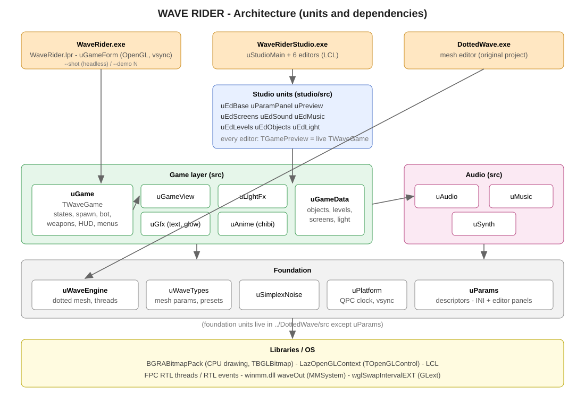
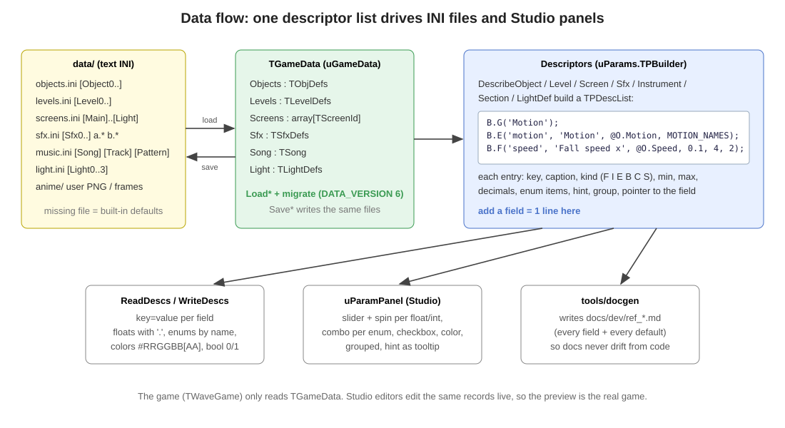
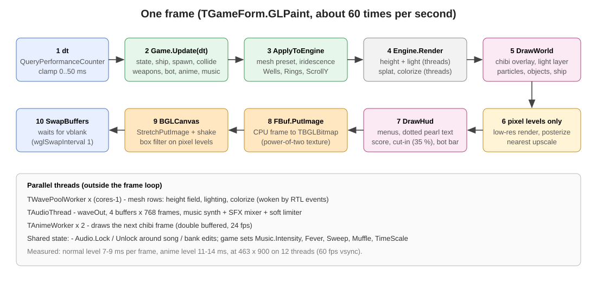

# 2. สถาปัตยกรรม

[← กลับสารบัญ](../DEVELOPER_GUIDE.md)

## 2.1 โปรแกรมทั้ง 3 ตัว

| โปรแกรม | โปรเจกต์ | หน้าที่ |
|---|---|---|
| `WaveRider.exe` | `WaveRider/WaveRider.lpi` | ตัวเกม หน้าต่าง OpenGL + vsync และโหมด headless `--shot` / `--demo N` |
| `WaveRiderStudio.exe` | `WaveRider/studio/WaveRiderStudio.lpi` | 6 editor (หน้าจอ เสียง เพลง ด่าน วัตถุ แสง) พร้อมหน้าจอจำลองเกมจริง |
| `DottedWave.exe` | `DottedWave/DottedWave.lpi` | โปรแกรมเดิมสำหรับปรับคลื่นจุด หน้าต่างควบคุมแยก และ Export |

ทั้งสามใช้ engine คลื่นชุดเดียวกันจาก `DottedWave/src`

## 2.2 โฟลเดอร์และไฟล์

```
UI07/
├─ 19829fdf…png              ภาพต้นแบบ 736×1431
├─ IMAGE_ANALYSIS.md          ผลวิเคราะห์ภาพ
├─ DottedWave/                engine + โปรแกรมปรับคลื่น
│  ├─ DottedWave.lpi/.lpr
│  ├─ src/uwaveengine.pas     ตัววาดคลื่นจุด (multi-thread)                 654
│  ├─ src/uwavetypes.pas      พารามิเตอร์ 37 ตัว, preset 8, INI/JSON/Pascal   411
│  ├─ src/usimplexnoise.pas   simplex noise 3 มิติ                          123
│  ├─ src/uplatform.pas       นาฬิกา QPC, vsync                             64
│  ├─ src/umainform.pas       หน้าต่างแสดงผลของ DottedWave                  295
│  ├─ src/ucontrolform.pas    หน้าต่างควบคุม + export                       774
│  └─ docs/                   preview_*.png, spec_default.json, preset_default.inc
└─ WaveRider/
   ├─ WaveRider.lpi/.lpr      โปรเจกต์เกม (lpr มีโหมด headless)              159
   ├─ src/                    unit ของเกม (หัวข้อ 2.3)                      9,904
   ├─ studio/                 WaveRiderStudio.lpi/.lpr + src/ (หัวข้อ 2.4)   3,907
   ├─ tools/                  audiotest, lighttest, animetest, docgen, contact
   ├─ data/                   objects / levels / screens / sfx / music / light .ini, anime/
   ├─ bin/                    WaveRider.exe, WaveRiderStudio.exe, waverider.ini
   ├─ docs/                   DEVELOPER_GUIDE.md, dev/ (เอกสาร + svg), img/ (ภาพหน้าจอ)
   └─ README.md               คู่มือผู้เล่น (อังกฤษ)
```

## 2.3 Unit ของเกม (`WaveRider/src`)



| Unit | บรรทัด | หน้าที่ | ชนิด / ฟังก์ชันหลัก |
|---|---|---|---|
| `uGame` | 3,701 | ตรรกะเกมทั้งหมด | `TWaveGame`: state, spawn, collide, effect, บอท, อาวุธ, แสง, เมนู, HUD |
| `uGameData` | 1,067 | โมเดลข้อมูล ค่าเริ่มต้น migration | `TObjDef`, `TLevelDef`, `TScreenFx`, `TGameData`, `Describe*`, `Default*` |
| `uAnime` | 1,072 | ตัวละคร chibi และผู้กำกับช็อต | `DrawChibi`, `TAnimeDirector`, `TAnimeWorker` |
| `uLightFx` | 899 | ray tracing แสงแยกสี | `TLightScene`, `TLightLayer`, `BuildKindScene`, `ProbeExit`, `SpectrumRGB` |
| `uSynth` | 770 | เสียงสังเคราะห์ + SFX bank | `TSynthParams`, `VoiceSample`, `RenderSfx`, `DefaultSfxBank`, `WriteWav` |
| `uMusic` | 753 | เพลง sequencer และ FX ตามเกม | `TSong`, `TSongPlayer`, `DefaultSong` |
| `uGfx` | 506 | ตัวอักษรจุดมุก cache ข้อความและ glow | `TDotText`, `TTextCache`, `TGlowCache`, `Posterize` |
| `uAudio` | 428 | เธรด waveOut + mixer | `TAudioEngine`, ตัวแปร global `Audio` |
| `uGameForm` | 321 | หน้าต่าง OpenGL, input, loop | `TGameForm.GLPaint`, `RenderScale`, `AppDeactivate` |
| `uParams` | 271 | descriptor ฟิลด์ → INI + panel | `TPBuilder`, `ReadDescs`, `WriteDescs`, `DescValueText` |
| `uGameView` | 116 | ประกอบเฟรม (ปกติ / pixel art) | `TGameRenderer.Render` |

## 2.4 Unit ของ Studio (`WaveRider/studio/src`)

| Unit | บรรทัด | หน้าที่ |
|---|---|---|
| `uEdMusic` | 991 | step sequencer 32×8, arrangement, เครื่องดนตรี, จำลองคอมโบ |
| `uEdSound` | 503 | เสียง 2 ชั้น, waveform, วัดเบส, template, export WAV |
| `uEdObjects` | 433 | วัตถุ, ตัววาด pixel art, ซูม sprite |
| `uParamPanel` | 388 | สร้างแผงควบคุมจาก descriptor อัตโนมัติ |
| `uEdBase` | 348 | ฐานของ editor แบบรายการ (Add / Dup / Delete / Save / Revert / Defaults) |
| `uStudioMain` | 301 | หน้าต่างหลัก, เปิด editor, Save all / Reload all |
| `uEdLevels` | 296 | ด่าน, กราฟ spawn, ตรวจ mix |
| `uPreview` | 274 | หน้าจอจำลองเกม (`TWaveGame` ของตัวเอง) |
| `uEdLight` | 179 | แสง 4 แบบ + โหมดสาธิต |
| `uEdScreens` | 150 | 9 หน้าจอ |

## 2.5 หลักการออกแบบ

1. **Descriptor ชุดเดียวใช้หลายงาน** — ฟิลด์ที่ประกาศใน `Describe*` ด้วย `B.F/I/E/B/C/S` ได้ทั้งการอ่าน/เขียน INI, แผงใน Studio และตารางในเอกสาร (`tools/docgen`)

   

2. **เกมไม่ผูกกับหน้าต่าง** — `TWaveGame` ไม่ใช้ LCL ใช้ซ้ำได้ในเกม ใน Studio preview และในโหมด headless
3. **engine ไม่รู้จักเกม** — เกมสั่ง engine ผ่าน hook 4 ตัว: `Wells` (เนิน/หลุม/เงา), `Rings` (คลื่นวง), `ScrollY` (การไหล), `Image` (ภาพที่จุดวาดตาม)
4. **ข้อมูลไม่มีวันหาย** — ไฟล์ที่ไม่มีใช้ค่าเริ่มต้นในโค้ด ไฟล์เก่าถูก migrate ตอนโหลด (`DATA_VERSION = 6`)
5. **ไม่มีงานศิลป์ภายนอก** — ภาพ เสียง และเพลงสร้างจากโค้ดทั้งหมด

## 2.6 ระบบพิกัด

- ตำแหน่งในเกมทั้งหมดเป็น **reference px** ของแคนวาส 736×1431 (ภาพต้นแบบ)
- ตอนวาดคูณด้วย `K = ความสูงบิตแมปจริง / 1431`
- ความละเอียดภายในของเกมถูกจำกัดที่ประมาณ **520,000 พิกเซล** (`TGameForm.RenderScale = min(1, sqrt(520000 / (w×h)))`) แล้วขยายขึ้นจอด้วย OpenGL
- ยานถูกจำกัดในช่วง x 24 … W−24 และ y 22 % … H−50

## 2.7 ลำดับการทำงานต่อเฟรม



| ขั้น | ที่ | รายละเอียด |
|---|---|---|
| 1 | `GLPaint` | `dt` จาก QueryPerformanceCounter จำกัด 0–50 ms |
| 2 | `TWaveGame.Update` | state, ยาน, spawn, ชน, effect ตามเวลา, เกรตติง, prism, diamond, newton, อนิเมะ, เพลง |
| 3 | `ApplyToEngine` | เลือก preset mesh ของด่านหรือหน้าจอ, iridescence ตามคอมโบ, `Wells` ของยานและวัตถุ, `Rings` |
| 4 | `TWaveEngine.Render` | height (เธรด) → แสงและสี (เธรด) → splat → colorize (เธรด) |
| 5 | `DrawWorld` | chibi (≈35 %), ชั้นแสง additive, อนุภาค, วัตถุ, ยาน, อาวุธ |
| 6 | `TGameRenderer` | ด่าน pixel: วาดความละเอียดต่ำ → posterize → ขยายแบบ nearest |
| 7 | `DrawHud` | เมนู, ตัวอักษรจุดมุก, คะแนน, ป้ายชื่อด่าน, cut-in, แถบ WATCH BOT |
| 8 | `FBuf.PutImage` | คัดลอกเฟรม CPU ลง `TBGLBitmap` |
| 9 | `BGLCanvas.StretchPutImage` | ขยายขึ้นจอ + การสั่นของจอ (shake) |
| 10 | `SwapBuffers` | รอ vblank (`wglSwapIntervalEXT(1)`) |

ทำไมต้องวาดลง `TBGRABitmap` ก่อนแล้วค่อยคัดลอก: `TBGLBitmap` จองความกว้างเป็นเลขยกกำลังสอง ทำให้ตำแหน่งข้อความเพี้ยน

## 2.8 เธรด

| เธรด | จำนวน | งาน | การประสาน |
|---|---|---|---|
| หลัก (LCL) | 1 | `Application.OnIdle` → `GLPaint` ทุกเฟรม | — |
| `TWavePoolWorker` | จำนวน core − 1 | แบ่งแถวของ mesh: height, แสง, colorize | RTL event ปลุก/รอ ผลตรงกับแบบเธรดเดียวทุกพิกเซล |
| `TAnimeWorker` | 2 | วาด chibi เฟรมถัดไป (24 fps, double buffer) | ป้าย `BmpShot` กันภาพของช็อตเก่า |
| `TAudioThread` | 1 | waveOut 4 บัฟเฟอร์ × 768 เฟรม | `Audio.Lock / Unlock` เมื่อแก้เพลงหรือ SFX bank |

ค่าที่เกมส่งให้เพลง (`Intensity`, `Fever`, `Sweep`, `Muffle`, `TimeScale`) เป็น Single ที่เขียนจากเธรดหลักและอ่านจากเธรดเสียง ไม่ต้องล็อก
