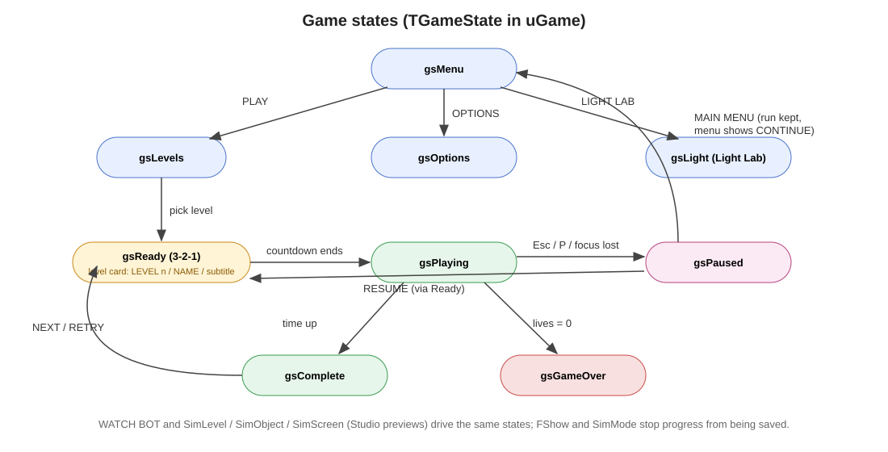
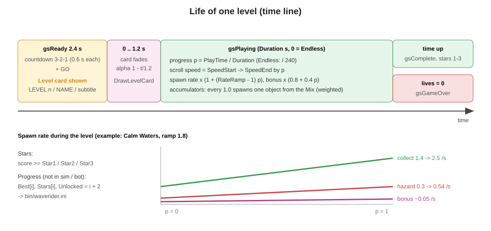
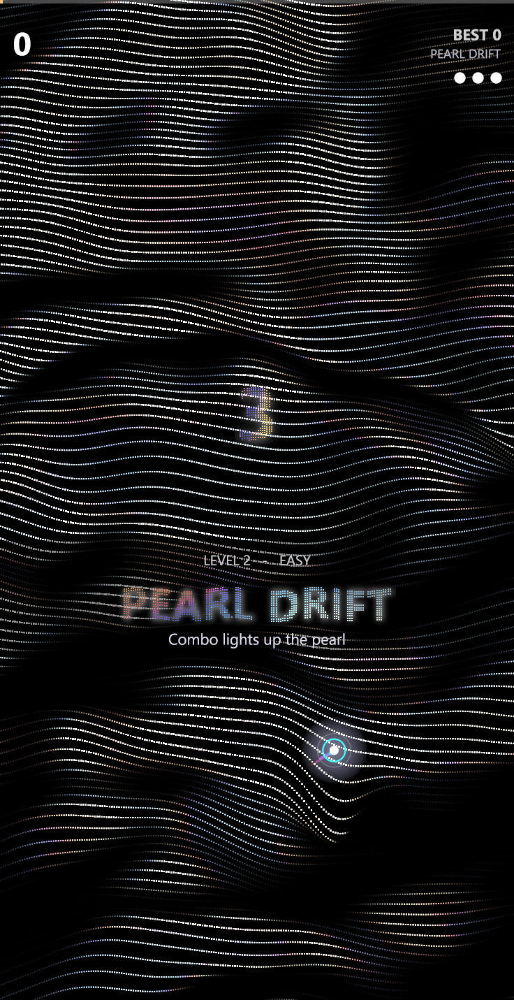
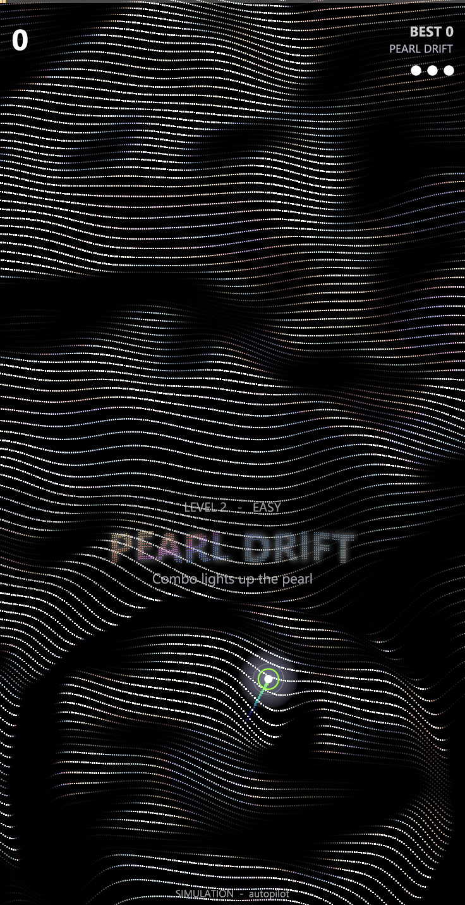
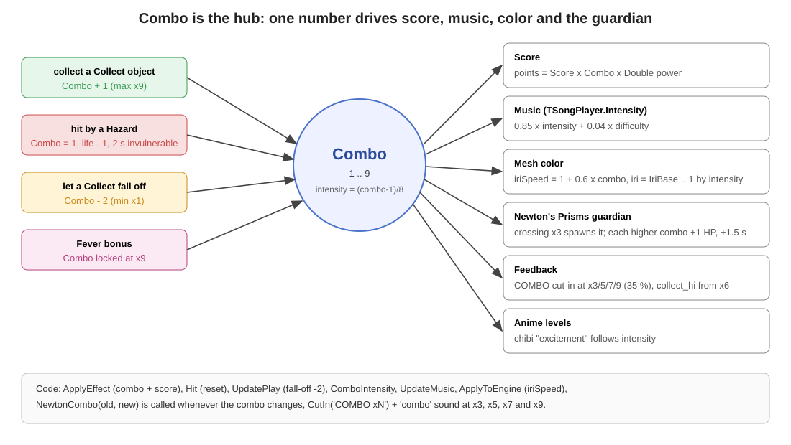
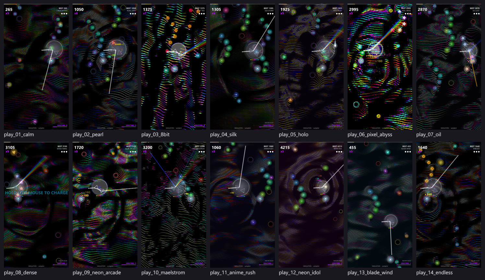
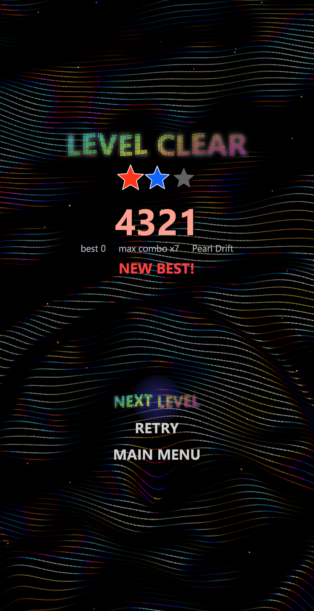
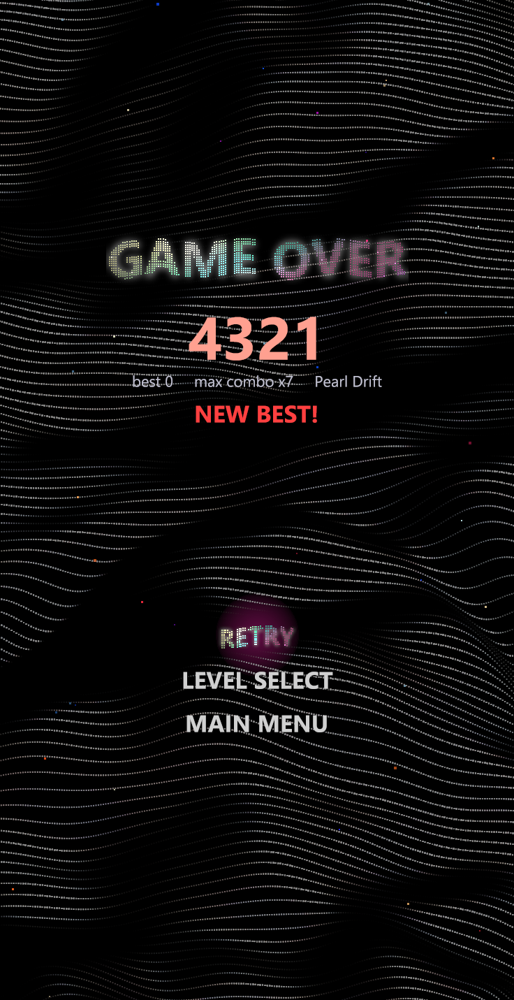
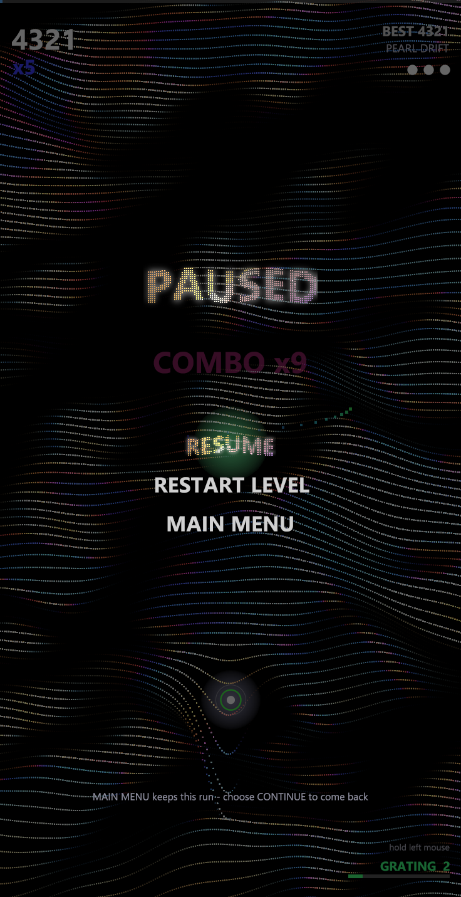

# 4. Gameplay

[← กลับสารบัญ](../DEVELOPER_GUIDE.md) · อ้างอิง: [ref_objects.md](ref_objects.md) · [ref_levels.md](ref_levels.md)

ที่มา: `src/ugame.pas` (`TWaveGame`), `src/ugamedata.pas`

## 4.1 สถานะของเกม



`TGameState = gsMenu, gsLevels, gsOptions, gsLight, gsReady, gsPlaying, gsPaused, gsComplete, gsGameOver`

| จาก | เหตุการณ์ | ไป |
|---|---|---|
| gsMenu | PLAY / ENDLESS / WATCH BOT / LIGHT LAB / OPTIONS / QUIT | gsLevels / gsReady / gsReady (บอท) / gsLight / gsOptions / ปิด |
| gsMenu | CONTINUE (มีเมื่อพักเกมค้างไว้) | gsReady (นับ 1.8 วินาที) แล้วเล่นต่อจากจุดเดิม |
| gsLevels | เลือกด่านที่ปลดล็อกแล้ว | gsReady |
| gsReady | นับถอยหลัง 2.4 วินาทีจบ | gsPlaying |
| gsPlaying | Esc / P / หน้าต่างหลุด focus (ไม่ใช่บอท) | gsPaused |
| gsPaused | RESUME | gsReady (นับ 1.2 วินาที) → gsPlaying |
| gsPaused | RESTART LEVEL / MAIN MENU | gsReady / gsMenu (เก็บเกมไว้: `FSuspended`) |
| gsPlaying | หมดเวลาด่าน | gsComplete |
| gsPlaying | ชีวิตเหลือ 0 | gsGameOver |
| gsComplete | NEXT LEVEL / RETRY / MAIN MENU | gsReady / gsReady / gsMenu |
| gsGameOver | RETRY / LEVEL SELECT / MAIN MENU | gsReady / gsLevels / gsMenu |

โหมดจำลอง: `SimMode = smLevel / smObject / smScreen` (Studio) และ `FShow` (WATCH BOT) ไม่บันทึก progress

## 4.2 ชีวิตของด่านหนึ่งด่าน



| ช่วง | สิ่งที่เกิด |
|---|---|
| **gsReady** 2.4 วินาที | นับ 3-2-1 (ตัวละ 0.6 วินาที) แล้ว GO · **ป้ายชื่อด่าน** แสดงเต็ม: `LEVEL n - DIFFICULTY` / ชื่อด่านตัวใหญ่ / subtitle (`DrawLevelCard`, alpha 1) |
| 1.2 วินาทีแรกของ gsPlaying | ป้ายชื่อด่านจางหาย alpha = 1 − PlayTime/1.2 |
| gsPlaying | `p = PlayTime / Duration` (Endless ใช้ /240) ควบคุมความเร็วและอัตรา spawn |
| จบ | หมดเวลา → ดาว 1–3 ตาม `Star1/2/3` · ชีวิตหมด → Game over |

| ป้ายชื่อด่าน (gsReady) | ขณะจางหาย |
|---|---|
|  |  |

## 4.3 ยานและการควบคุม

| อินพุต | ผล |
|---|---|
| เมาส์ | ยานตาม cursor แบบ easing (`dt × 14`) |
| ลูกศร / WASD | แรงเร่ง 5200 px/s², หน่วง `0.0008^dt`, ความเร็วสูงสุด 950 px/s (กดปุ่มแล้วเปลี่ยนเป็นโหมดคีย์บอร์ด) |
| เมาส์ซ้ายค้าง / Space ค้าง | ชาร์จ Grating, ปล่อย = ยิง ([05_lightfx.md](05_lightfx.md)) |
| Esc / P | Pause |

- รัศมีชนของยาน `SHIP_R = 16`
- ชนศัตรูเมื่อ `ระยะ < 16 + R × 0.8` · เก็บของเมื่อ `ระยะ < 16 + R + 6` (เก็บง่ายกว่าชน)
- หลังโดนชน อมตะ 2 วินาที

## 4.4 คอมโบและคะแนน



| เหตุการณ์ | คอมโบ |
|---|---|
| เก็บวัตถุ Collect | +1 (สูงสุด `MAX_COMBO = 9`) |
| โดนศัตรู (ไม่มี Shield) | กลับเป็น 1 และเสียชีวิต 1 |
| ปล่อยวัตถุ Collect หลุดขอบล่าง | −2 (ต่ำสุด 1) |
| Fever | ล็อกที่ x9 ตลอดเวลา effect |

- **คะแนน** Collect = `Score × Combo × ตัวคูณ Double`, Bonus = `Score × ตัวคูณ Double`
- ทุกครั้งที่คอมโบถึง **x3, x5, x7, x9**: เสียง `combo`, banner และ cut-in `COMBO xN!` (โปร่งแสง ≈35 %), filter sweep ของเพลง
- ตั้งแต่ x6 ใช้เสียง `collect_hi` ที่ pitch สูงขึ้นทีละขั้น
- คอมโบข้าม x3 → Newton's Prisms เกิด ([05_lightfx.md](05_lightfx.md))

## 4.5 วัตถุ (21 ชนิด)

ทุกวัตถุเป็นข้อมูล `TObjDef` 38 ฟิลด์ (ฟิลด์ครบใน [ref_objects.md](ref_objects.md))

| บทบาท | วัตถุ | หมายเหตุ |
|---|---|---|
| **Collect** | Spark (10), Prism (40), Coin (20, pixel), Gem (60), GratingCell (5) | GratingCell ให้พลัง Grating +1 |
| **Hazard** | Void (Drift), Seeker (Homing 140 px/s), Comet (Fast ×2.3), Twin (Orbit คู่), Glitch (ZigZag, pixel) | effect = Damage |
| **Bonus** | Pulse, Shield, Magnet, SlowMo, Double, OneUp, Star, Fever, Nova, Diamond, Spectrum | ดูตาราง effect ด้านล่าง |

**การเคลื่อนที่ (`motion`)**

| ค่า | สูตร |
|---|---|
| Fall | ตกตรงด้วยความเร็วด่าน × `speed` |
| Sine / Drift | `x = BX + sin(age × freq + phase) × amp` |
| ZigZag | คลื่นสามเหลี่ยม `amp`, ความถี่ `freq/2` |
| Homing | เลื่อน x เข้าหายานไม่เกิน `power` px/s (เฉพาะเมื่ออยู่เหนือยาน) |
| Orbit | วงกลมรอบจุดที่ตก รัศมี `amp` (spawn เป็นคู่เฟสตรงข้าม) |
| Fast | ตกเร็วตาม `speed` |

**รูปลักษณ์ (`style`)**: Orb, Ring, Void, Triangle, Star, Pixel (ใช้ `pixelArt`), Comet, Prism, Gem, Grating · **โหมดสี (`colorMode`)**: Fixed, HueCycle, Pearl, Holo, Oil, Rainbow, Beetle

**ผลเมื่อเก็บ (ทุกวัตถุ)**: วงคลื่นบน mesh (`ring*`), อนุภาค (`particles`), จอสั่น (`shake`), แสงวาบ (`flash`), filter sweep ของเพลง (`musicSweep`), เสียง (`sfx`, `sfxPitch`)

## 4.6 Effect ทั้ง 13 แบบ

| Effect | ตัวอย่างวัตถุ | ผล | ใช้ `duration` / `power` |
|---|---|---|---|
| Score | Spark, Star | ให้คะแนนอย่างเดียว | — |
| ClearHazards | Pulse | ล้างศัตรูบนจอ +25 ต่อตัว | — |
| Shield | Shield | กันการชน (`BLOCKED`) | 8 s |
| Magnet | Magnet | ดึง Collect ในรัศมี `power` | 8 s / 280 px |
| SlowMo | SlowMo | โลกช้าลงเหลือ `power`, เพลงช้า 0.82 | 6 s / 0.55 |
| DoubleScore | Double | คะแนน × `power` | 10 s / 2 |
| ExtraLife | OneUp | ชีวิต +1 (สูงสุด 6) | — |
| Fever | Fever | คอมโบ x9 ตลอด, เพลง trance gate | 6 s |
| Nova | Nova | ล้างศัตรู +40 ต่อตัว | — |
| Damage | ศัตรูทุกชนิด | เสียชีวิต คอมโบ = 1 | — |
| LightBeam | Spectrum | Prism sentinel (ขั้นต่ำ 10 s) | 5 s × 2 |
| GratingPower | GratingCell | พลัง Grating + `power` | — |
| DiamondLight | Diamond | เพชรดูดของเข้ายาน | 5 s |

effect ที่มีเวลาเก็บใน `FFx[EF_SHIELD..EF_DIAMOND]` (`T`, `Dur`, `Def`) นับด้วยเวลาจริง (ไม่ช้าลงตาม Slow-mo) หมดเวลาแล้วขึ้น `<CAPTION> OFF`

## 4.7 การเกิดวัตถุ (spawn)

```
ramp   = 1 + (RateRamp − 1) × p
collect += CollectRate × ramp × dt
hazard  += HazardRate  × ramp × dt
bonus   += BonusRate   × (0.8 + 0.4 p) × dt
เมื่อสะสมครบ 1 → สุ่มวัตถุจาก Mix ตามน้ำหนัก
```

- Mix เขียนเป็น `ชื่อ:น้ำหนัก` เช่น `Spark:5 Prism:1 Gem:1 GratingCell:2`
- `chain` = โอกาสที่ Collect เกิดเป็นแถวโค้งต่อเนื่อง
- ความเร็วเลื่อน = `SpeedStart → SpeedEnd` ตาม `p`
- WATCH BOT คูณความยากเพิ่ม (`HardMul`, ดู [06_bot.md](06_bot.md))

ค่า rate / mix ของทุกด่านอยู่ใน [ref_levels.md](ref_levels.md)

## 4.8 ด่านทั้ง 14

| # | ชื่อ | ระดับ | สไตล์ | เวลา |
|---|---|---|---|---|
| 1 | Calm Waters | Easy | Original | 45 s |
| 2 | Pearl Drift | Easy | Iridescent Pearl | 60 s |
| 3 | 8-Bit Tide | Normal | Sound Wave + pixel 4 px | 60 s |
| 4 | Silk Storm | Normal | Calm Silk | 75 s |
| 5 | Holo Rush | Hard | Holographic | 75 s |
| 6 | Pixel Abyss | Hard | Original + pixel 5 px | 80 s |
| 7 | Oil Slick | Hard | Oil Slick | 90 s |
| 8 | Dense Fabric | Expert | Dense Fabric | 90 s |
| 9 | Neon Arcade | Expert | Holographic + pixel 3 px | 90 s |
| 10 | The Maelstrom | Insane | Storm | 120 s |
| 11 | Anime Rush | Normal | chibi Party | 70 s |
| 12 | Neon Idol | Hard | chibi Neko | 80 s |
| 13 | Blade Wind | Expert | chibi Ao | 90 s |
| 14 | Endless | Insane | Iridescent Pearl | ไม่จำกัด |



**ด่าน Pixel Art:** วาดทั้งฉากที่ความละเอียดต่ำ (`pixelSize`), ลดจำนวนสีต่อช่อง (`posterize`) แล้วขยายแบบ nearest (`TGameRenderer`)

## 4.9 จบด่านและ progress

- ดาว: คะแนน ≥ `Star1` / `Star2` / `Star3`
- บันทึก (ยกเว้นโหมดจำลองและบอท): `Best[i]`, `Stars[i]`, `Unlocked = max(Unlocked, i + 2)` ลง `bin/waverider.ini`
- ถ้าคะแนนสูงกว่าเดิม ขึ้น `NEW BEST!`

| Complete | Game over | Pause |
|---|---|---|
|  |  |  |
