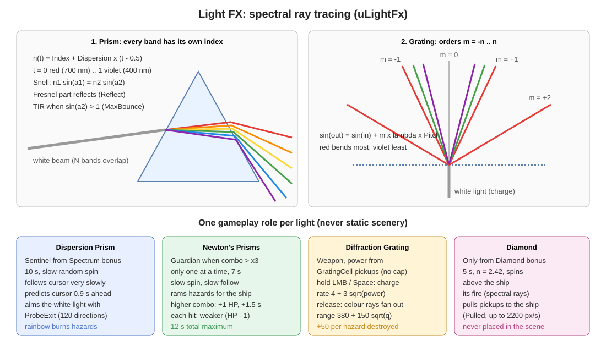
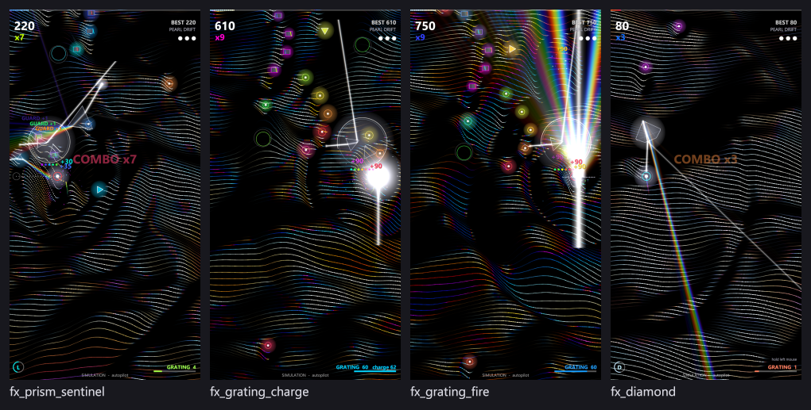
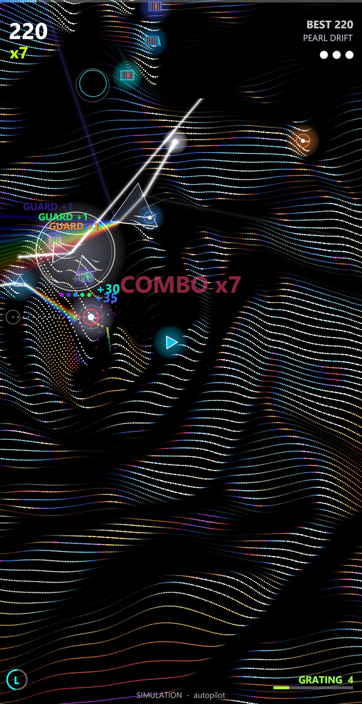
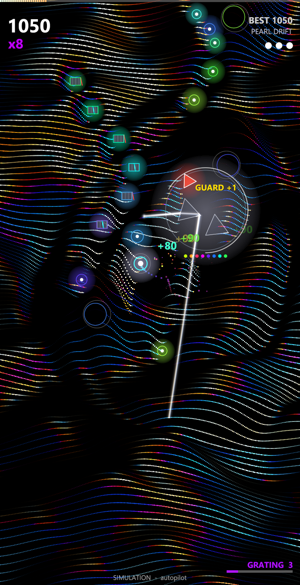
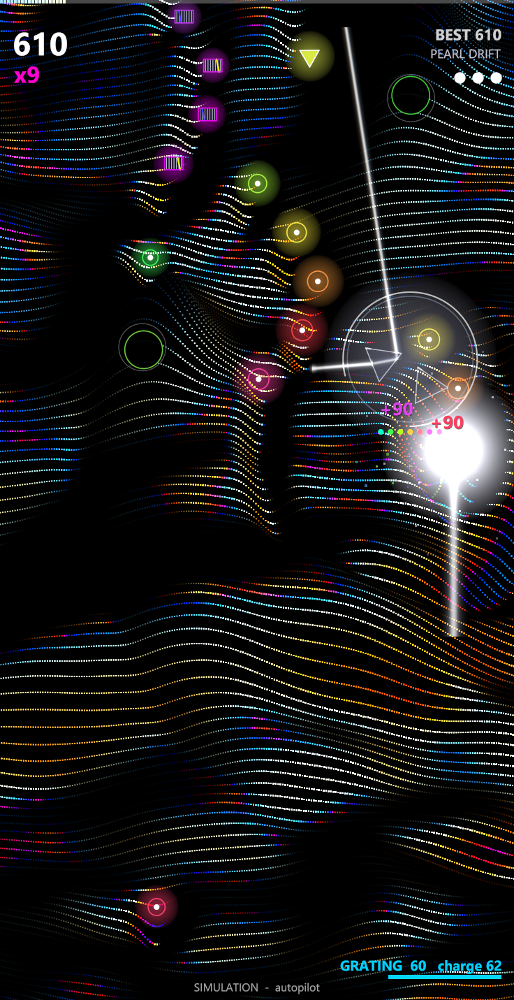
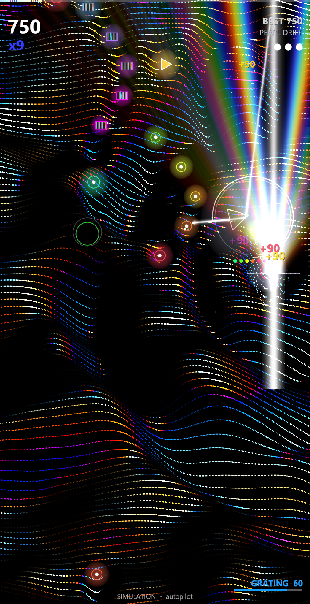
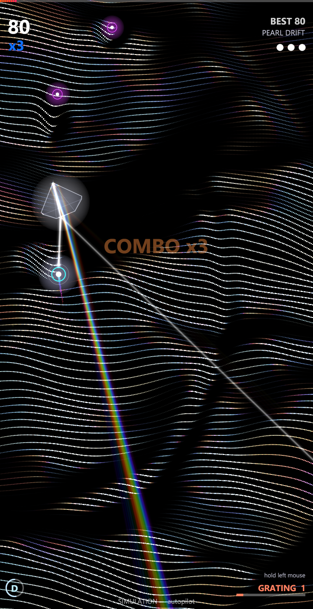

# 5. แสง 4 แบบ (Light FX)

[← กลับสารบัญ](../DEVELOPER_GUIDE.md) · อ้างอิง: [ref_light.md](ref_light.md)

ที่มา: `src/ulightfx.pas` (ฟิสิกส์ + การวาด), `src/ugame.pas` (หน้าที่ในเกม)

## 5.1 หลักฟิสิกส์ (`TLightScene`)

| เรื่อง | การทำงานในโค้ด |
|---|---|
| แสงขาว | ลำแสงเดียวแยกเป็น `Bands` แถบ (3–32) จากแดง 700 nm ถึงม่วง 400 nm สีของแต่ละแถบจาก `SpectrumRGB` (สูตร Dan Bruton) ทุกแถบรวมกันได้สีขาว |
| ดัชนีหักเห | `n(t) = Index + Dispersion × (t − 0.5)` แต่ละแถบหักเหไม่เท่ากัน จึงแยกเป็นรุ้ง |
| การหักเห | กฎ Snell ที่ทุกผิวของรูปหลายเหลี่ยม (`TOpticElem.Pts` เรียงทวนเข็ม) |
| การสะท้อน | สะท้อนกลับหมด (TIR) เมื่อ sin > 1, สะท้อนบางส่วนแบบ Fresnel ด้วยน้ำหนัก `Reflect`, ไม่เกิน `MaxBounce` ครั้ง |
| เกรตติง | `sin θm = sin θi + m · λ · Pitch` สำหรับ m = −Orders … +Orders |
| การวาด | ทุกช่วงของรังสีเป็น `TLightSeg` วาดลง `TLightLayer` (float RGB, additive, แกนคม + halo) สีที่ทับกันจึงผสมแบบแสง แล้ว `Composite` ลงเฟรม |
| การชน | `HitsCircle(cx, cy, r)` ตรวจว่ารังสีใดผ่านวงกลม (ใช้ทำลายศัตรู / ดูดของ) |
| ตัวช่วยเล็ง | `ProbeExit` ยิงรังสีกลางสเปกตรัมหนึ่งเส้นผ่านแก้ว คืนจุดและทิศทางที่ออก |

## 5.2 หลักการ: หนึ่งแสง หนึ่งหน้าที่

ไม่มีแสงแบบใดเป็นฉากหลังหรือของประดับ ฉากแสงหลังด่าน (`lightScene`), แสงวาบตอนเก็บโบนัส และ screen light ของเมนูถูกปิด และ migration ล้างค่าเก่าทิ้งตอนโหลด

| แสง | เกิดจาก | หน้าที่ | ระยะเวลา |
|---|---|---|---|
| Dispersion Prism | โบนัส **Spectrum** | Sentinel ยิงรุ้งเผาศัตรูบนเส้นทางที่ cursor กำลังจะไป | 10 วินาที (ขั้นต่ำ) |
| Newton's Prisms | คอมโบข้าม **x3** | Guardian ชนศัตรูแทนผู้เล่น | 7 วินาที (สูงสุดรวม 12) |
| Diffraction Grating | เก็บ **GratingCell** | อาวุธ ชาร์จแล้วยิงลำแสงสี | ตามที่ชาร์จ |
| Diamond | โบนัส **Diamond** | ดูดของสะสมเข้ายาน | 5 วินาที |

## 5.3 Dispersion Prism — Sentinel (`UpdatePrism`)

1. **หมุนสุ่มช้าๆ:** ความเร็วเชิงมุมเดินสุ่ม จำกัด ±0.45 rad/s
2. **ตาม cursor ช้ามาก:** เลื่อนเข้าหาจุดเหนือ cursor 230 px ด้วยอัตรา `dt × 0.35`
3. **เดาทิศทาง:** วัดความเร็ว cursor (กรองแบบ smooth) แล้วทำนายตำแหน่งล่วงหน้า `LEAD = 0.9` วินาที
4. **เลือกเป้า:** ศัตรูที่ใกล้เส้นทาง cursor → ตำแหน่งทำนายมากที่สุด (ภายใน 200 px, ยิ่งใกล้ยิ่งด่วน) ถ้าไม่มีศัตรู ส่องทางข้างหน้า
5. **แก้มุมแสงตามฟิสิกส์:** ลองทิศของแสงขาว 120 ทิศรอบปริซึม แต่ละทิศใช้ `ProbeExit` ผ่านแก้วจริง (Snell + TIR) เลือกทิศที่แสงสีออกไปชี้ตรงเป้าที่สุด (เพิ่มโทษเล็กน้อยเมื่อเปลี่ยนมุมมาก ให้เคลื่อนที่นุ่ม) ตะเกียงหมุนรอบปริซึมไปยังมุมนั้นได้ไม่เกิน 3.2 rad/s
6. **เผาศัตรู:** ศัตรูที่โดนรังสีสะสม `Heat` ครบ 0.22 วินาทีถูกทำลาย +40

ค่าที่ใช้: dispersion × 2.5 (พัดรุ้งกว้างอ่านง่าย), อย่างน้อย 16 แถบ, ลำแสงยาว 1500 · ผลทดสอบ: แก้มุมสำเร็จ 73 % ของเฟรม (`fx_prism_sentinel`)

## 5.4 Newton's Prisms — Guardian (`NewtonCombo`, `UpdateNewton`)

1. **เกิด:** เมื่อคอมโบเพิ่มจาก ≤ x3 เป็น > x3 และยังไม่มีตัวอื่นอยู่ (มีได้ตัวเดียว) HP เริ่ม 2, เวลา 7 วินาที, banner `NEWTON'S PRISMS`
2. **คอมโบสูงขึ้นอีก:** HP +1 (สูงสุด 8), เวลา +1.5 วินาที แต่อายุรวมไม่เกิน 12 วินาที, ขึ้น `GUARD +1`
3. **เคลื่อนที่:** หมุนช้าๆ (0.25–0.7 rad/s สุ่ม), ตามจุดเหนือ cursor 130 px ด้วยอัตรา `dt × 0.9`
4. **ชนศัตรู:** รัศมีชน `NewtonSize` (โตตาม HP) ศัตรูที่ชนถูกทำลาย +30, HP −1, กระพริบ ถ้า HP = 0 แตก `GUARDIAN BROKEN`
5. **ภาพ:** ปริซึมสองชิ้นแบบการทดลองของนิวตัน ชิ้นที่สองกระจายสเปกตรัมอีกครั้ง ลำแสงยาว `260 + 30 × HP` จางลงในช่วงท้าย

## 5.5 Diffraction Grating — อาวุธ (`FireDown`, `UpdateGrating`, `FireGrating`, `BuildShot`)

| ชาร์จ (กดค้าง) | ยิง (ปล่อย) |
|---|---|
|  |  |

1. **เก็บพลัง:** GratingCell แต่ละชิ้น +`power` (สะสมไม่จำกัด แสดงที่ HUD `GRATING n`) ครั้งแรกขึ้นคำแนะนำ `HOLD LEFT MOUSE TO CHARGE`
2. **ชาร์จ:** กดเมาส์ซ้ายหรือ Space ค้าง พลังไหลเป็นแสงขาวใต้ยาน อัตรา `4 + 3·√(พลัง)` ต่อวินาที (มีมากชาร์จเร็ว) เสียง `charge` สูงขึ้นเรื่อยๆ
3. **ยิง:** ปล่อยปุ่ม ให้ `q = √charge`
   - จำนวน order = `1 + q/2` (1–7)
   - ระยะ = `380 + 150·q` · รังสียืดออกใน 0.18 วินาที
   - อายุลำแสง = `0.75 + min(1, 0.08·q)` วินาที
   - ความกว้าง แสงเรือง และความสว่างเพิ่มตาม q
4. **ทำลาย:** ศัตรูที่โดนรังสีใน 80 % แรกของอายุ +50 ต่อตัว
5. แสงขาวมาจากใต้ยาน ผ่านเกรตติงที่วางขวางยาน แล้วแตกเป็น order ตามสมการ (แดงเบนมากที่สุด ม่วงน้อยที่สุด)

## 5.6 Diamond — โบนัสดูดของ (`UpdateDiamond`)

1. **เกิดจากโบนัส Diamond เท่านั้น** ไม่เคยวางไว้ในฉาก
2. เพชร brilliant cut ขนาด 78 ลอยเหนือยาน 170 px หมุน 1.15 rad/s, n ≥ 2.2 (ค่าเริ่มต้น 2.42), dispersion ≥ 0.3, สะท้อนภายในได้ 9 ครั้ง
3. **ยานคือตะเกียง:** ลำแสงขาวจากยานส่องเข้าก้นเพชร (ส่ายเล็กน้อย) ประกายไฟรุ้งยาว 1100 พุ่งออกหลายทิศ
4. ของสะสมที่โดนประกายถูกตั้ง `Pulled` แล้วบินเข้ายาน (เร่งจนถึง 2200 px/s) เก็บอัตโนมัติ
5. ความสว่างจางลงในครึ่งวินาทีสุดท้าย

## 5.7 Light Lab และตัวเลือก

- เมนูหลัก > **LIGHT LAB**: อธิบายแสงทั้ง 4 แบบและหน้าที่ (ภาพ `screen_light_lab.png`)
- Options > **BEAM LIGHT**: เลือกชนิดแสงที่โบนัส Spectrum ใช้ (`LightMode`, ค่าเริ่มต้น Dispersion Prism)
- Options > **AMBIENT LIGHT**: เปิด/ปิด (ค่าเก่า ปัจจุบันไม่มีแสงประดับ)
- ค่าทุกแบบแก้ได้ใน Studio > Light FX (`data/light.ini`)

## 5.8 ประสิทธิภาพ

- `lighttest` วาดทั้ง 4 ฉากใน 15 ms
- `TLightLayer.Line` วาดทีละเส้นแบบ scan ฉากที่มีรังสีเกิน ~300 ช่วงจะช้าลง
