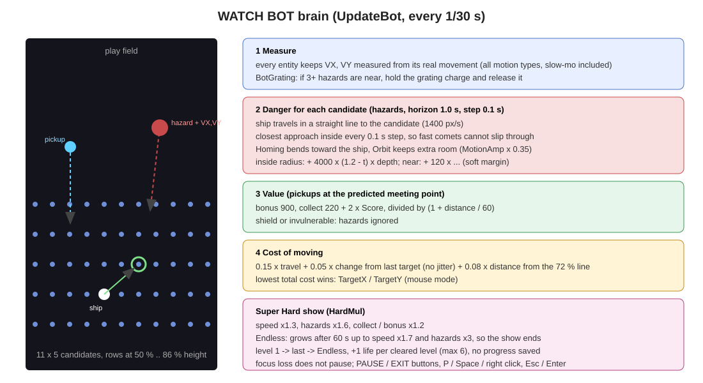

# 6. WATCH BOT

[← กลับสารบัญ](../DEVELOPER_GUIDE.md)

ที่มา: `src/ugame.pas` — `StartShow`, `StopShow`, `ShowStartLevel`, `UpdateShow`, `UpdateBot`, `BotGrating`, `HardMul`, `DrawShowHud`

## 6.1 การทำงานของโหมด

| เรื่อง | รายละเอียด |
|---|---|
| เริ่ม | เมนูหลัก > **WATCH BOT** |
| ลำดับ | ด่าน 1 → ด่านสุดท้ายก่อน Endless → Endless จนหมดชีวิต |
| ระหว่างด่าน | หน้า Complete 3.5 วินาทีแล้วไปด่านถัดไป, ผ่านด่านได้ชีวิตคืน 1 (สูงสุด 6) |
| จบ | Game over แสดง 7 วินาทีแล้วกลับเมนู |
| Progress | **ไม่บันทึก** (คะแนน ดาว ปลดล็อก) พลัง Grating ของผู้เล่นถูกเก็บแยก (`FSavedPower`) แล้วคืนให้ |
| Focus | หน้าต่างหลุด focus **ไม่ pause** (`AppDeactivate` ข้ามเมื่อ `IsShow`) |
| HUD | แถบล่าง `WATCH MODE · BOT · SUPER HARD`, ด่าน n/14, จำนวนด่านที่ผ่าน, คะแนนรวม, ปุ่ม PAUSE และ EXIT |

## 6.2 การควบคุมระหว่างดู

| อินพุต | ผล |
|---|---|
| คลิกปุ่ม **PAUSE** / P / Space / คลิกขวา | Pause (กดซ้ำเล่นต่อ) |
| คลิกปุ่ม **EXIT** / Esc / Enter | ออกไปเมนูหลัก |
| เคอร์เซอร์ | เป็นรูปมือเมื่อชี้ปุ่ม (`CursorKind = 2`) |

## 6.3 ความยาก Super Hard (`HardMul`)

| ค่าคงที่ | ค่า | คูณกับ |
|---|---|---|
| `SHOW_SPEED` | 1.3 | ความเร็วเลื่อน |
| `SHOW_HAZARD` | 1.6 | อัตราเกิดศัตรู |
| `SHOW_COLLECT` | 1.2 | อัตราเกิดของสะสมและโบนัส |

ในด่าน Endless ความยากเพิ่มต่อหลัง 60 วินาที: `× (1 + (t − 60)/150)` จำกัดที่ความเร็ว ×1.7 และศัตรู ×3 เพื่อให้การแสดงจบได้จริง

## 6.4 สมองบอท (`UpdateBot`)

ทุก 1/30 วินาที:

1. **เรียก `BotGrating`:** ถ้ามีพลัง ≥ 4 และศัตรู ≥ 3 ตัวอยู่ข้างหน้า (สูงกว่ายาน 40–650 px, ห่างแนวนอน < 320) เริ่มชาร์จ แล้วปล่อยเมื่อชาร์จครบ (สูงสุด 30) หรือเกิน 1.4 วินาที
2. **ตำแหน่งที่เป็นไปได้ 11 × 5 จุด** กว้างทั้งสนาม แถวที่ 50 %, 59 %, 68 %, 77 %, 86 % ของความสูง
3. **ต้นทุนของแต่ละจุด:**
   - การเดินทาง `0.15 × ระยะ` + การเปลี่ยนเป้า `0.05 × ระยะจากเป้าเดิม` (กันการสั่น) + `0.08 × ระยะจากเส้น 72 %`
   - **อันตราย:** ทุกศัตรู ทำนาย 1 วินาทีล่วงหน้า ทีละ 0.1 วินาที จากความเร็วที่วัดจริง (`VX`, `VY`) ขณะยานวิ่งเส้นตรงไปจุดนั้นด้วย 1400 px/s ใช้ระยะใกล้สุดภายในช่วง (comet เร็วๆ หลุดระหว่าง sample ไม่ได้) Homing เบนเข้าหายาน, Orbit เผื่อระยะ `MotionAmp × 0.35` · ชนแน่ `+4000 × (1.2 − t) × ความลึก`, เฉียด `+120 × …`
   - **มูลค่า:** ของสะสมและโบนัสที่ตำแหน่งพบกันที่ทำนาย โบนัส 900, ของสะสม `220 + 2 × Score` หารด้วย `1 + ระยะ/60`
   - มี Shield หรืออมตะ: ไม่สนใจศัตรู
4. เลือกจุดต้นทุนต่ำสุดเป็น `TargetX/Y` (โหมดเมาส์)

ความเร็ว `VX/VY` ของทุกวัตถุวัดจากการเคลื่อนที่จริงในแต่ละเฟรม จึงรองรับทุก motion รวมถึง Slow-mo

## 6.5 ผลที่วัดได้

| การทดสอบ | ผล |
|---|---|
| `--shot bot_watch.png 25 watch` (25 วินาทีแรก) | คอมโบ x9 ภายใน 10 วินาที, ไม่เสียชีวิต, 3,200 คะแนน |
| ทั้งเกม (วัดก่อนเพิ่มด่านอนิเมะ) | ผ่าน 10 ด่านในประมาณ 14 นาที จบใน Endless ประมาณ 19 นาที |

ล็อกทุก 5 วินาที: `docs/img/bot_watch.log`
