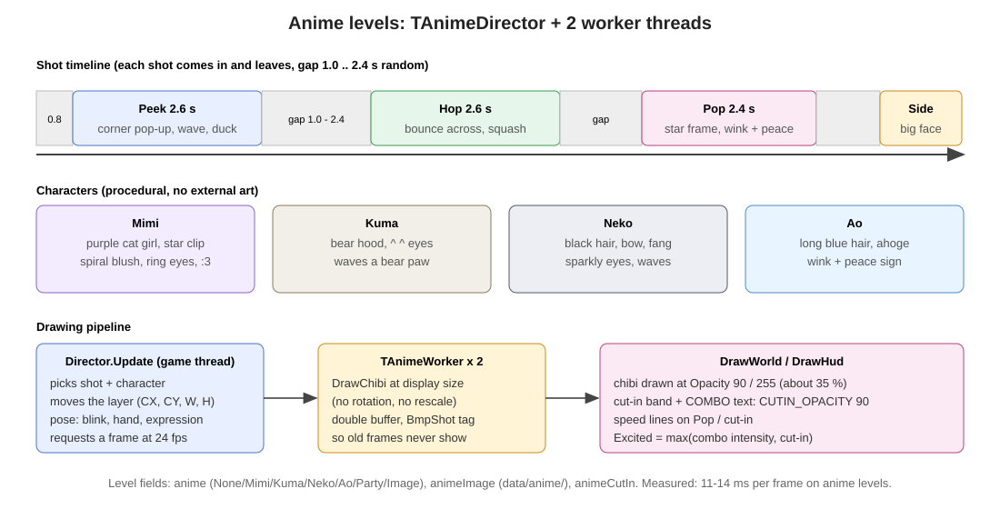
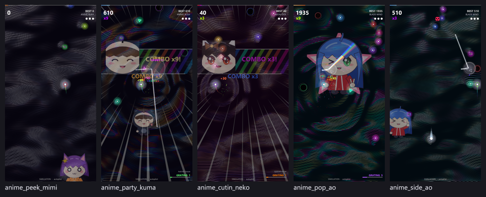
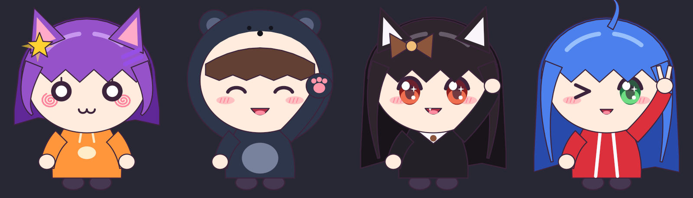
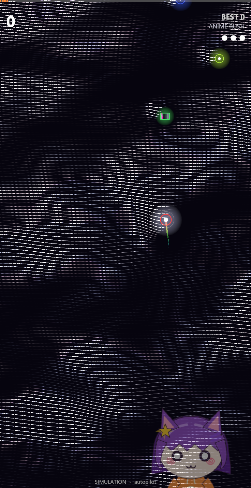
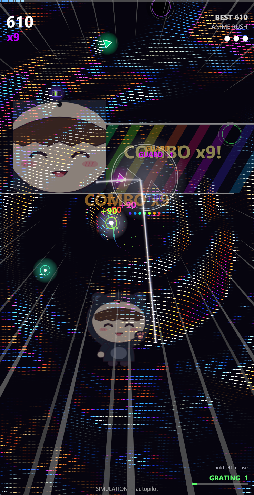
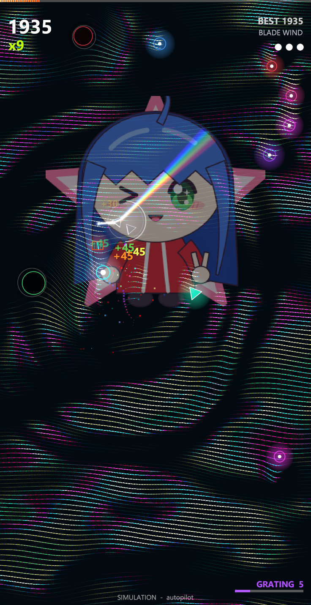
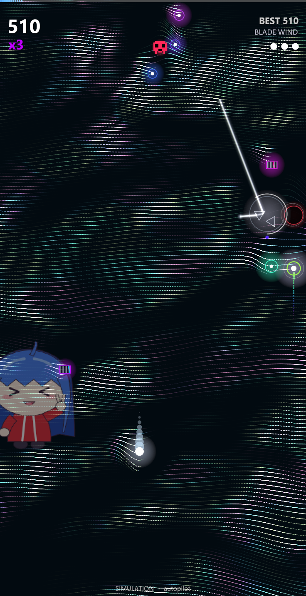
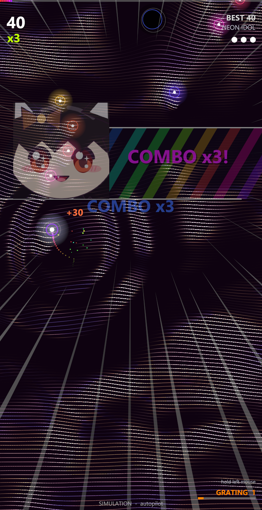

# 7. ด่านอนิเมะ (chibi)

[← กลับสารบัญ](../DEVELOPER_GUIDE.md)

ที่มา: `src/uanime.pas` (1,072 บรรทัด), ส่วนที่เรียกใช้ใน `src/ugame.pas` (`CutIn`, `DrawCutIn`, `DrawCutInBand`, `DrawSpeedLines`)

## 7.1 ตัวละคร (วาดด้วยโค้ดทั้งหมด)

| ค่า | ตัวละคร | ลักษณะ | สีหน้า / ท่ามือ (`DefaultChibiPose`) |
|---|---|---|---|
| 1 | **Mimi** | แมวผมม่วง กิ๊บดาว แก้มก้นหอย ตาวงแหวน ปาก `:3` | exCat |
| 2 | **Kuma** | เด็กผู้หญิงใส่ฮู้ดหมี | exHappy (`^ ^`), โบกอุ้งเท้าหมี (chPaw) |
| 3 | **Neko** | แมวผมดำ โบว์ เขี้ยวเล็ก | exSparkle (ตาประกาย), โบกมือ (chWave) |
| 4 | **Ao** | ผมยาวสีฟ้า ahoge | exWink, ชูสองนิ้ว (chPeace) |
| 5 | **Party** | ทั้ง 4 ตัวสลับกัน | — |
| 6 | **Image** | ภาพของผู้ใช้ | ดู 7.5 |

`DrawChibi(Bmp, Char, CX, Top, Height, Pose, Time)` วาดหัวโต ตัวเล็ก (สัดส่วน chibi) ด้วย ellipse/polygon แบบ antialias ส่วนประกอบ: ผม หู/ฮู้ด ใบหน้า ตา (ตามสีหน้า) แก้ม ปาก ตัว มือ อุปกรณ์ประจำตัว

**`TChibiPose`:** `Expr` (Happy, Cat, Wink, Sparkle, XD, Smile), `Blink` (1 เปิด … 0 ปิด), `Hand` (None, Wave, Peace, Paw), `HandUp` (0 … 1), `Frame` (กรอบดาวสีชมพูของท่า Pop)

## 7.2 ท่า (ช็อต) ที่ "เข้ามาและจากไป"

| ช็อต | ความยาว | การเคลื่อนไหว | ตัวอย่าง |
|---|---|---|---|
| **Peek** | 2.6 s | โผล่จากมุมล่าง เด้งยืดหด โบกมือ แล้วมุดลง |  |
| **Hop** | 2.6 s | กระโดดข้ามจอ ยุบตัวทุกครั้งที่ลงพื้น |  |
| **Pop** | 2.4 s | กรอบดาวสีชมพูเด้งเปิด ขยิบตาชูสองนิ้ว หายไปเป็นประกาย |  |
| **Side** | 2.6 s | หน้าใหญ่โผล่จากขอบจอ กระพริบตา แล้วเลื่อนกลับ |  |

- ระหว่างช็อตเว้น **1.0–2.4 วินาที** (สุ่ม) ช็อตแรกเริ่มหลัง 0.8 วินาที
- `Excited = max(ความเข้มคอมโบ, cut-in)` ทำให้ตัวละครดีใจมากขึ้นเมื่อคอมโบสูง

## 7.3 Cut-in

เมื่อคอมโบถึง x3/5/7/9 หรือเก็บโบนัส (และ `animeCutIn` เปิด) จะมีแถบเฉียงลายรุ้งพร้อมหน้าตัวละครและข้อความ เช่น `COMBO x5!` หรือชื่อโบนัส พร้อม speed lines

## 7.4 การวาดและความโปร่งแสง

| เรื่อง | ค่า |
|---|---|
| เธรด | `TAnimeWorker` × 2 วาดเฟรมถัดไปที่ 24 fps แบบ double buffer |
| ขนาด | วาดที่ขนาดแสดงจริง ไม่หมุน ไม่ย่อขยาย (เร็วขึ้นจาก 23–32 ms เหลือ 11–14 ms ต่อเฟรม) |
| กันภาพผิดช็อต | แต่ละบิตแมปมีป้าย `BmpShot` ถ้าไม่ตรงกับช็อตปัจจุบันจะไม่แสดง |
| ความทึบตัวละคร | `Opacity := 90` (≈35 %) |
| ความทึบ cut-in และข้อความ COMBO | `CUTIN_OPACITY = 90` (≈35 %) |
| เสียงสะท้อนบน mesh | `animeMix` × `EchoMix`: จุดของคลื่นวาดตามเลเยอร์ chibi ชั้น 0 เบาๆ |

ประวัติความทึบ: ครึ่งหนึ่ง (128) → popup ลดอีก 50 % → ทั้งหมดลดอีก 30 % = 90/255

## 7.5 ด่านอนิเมะและภาพของผู้ใช้

| ฟิลด์ด่าน | ความหมาย |
|---|---|
| `anime` | None, Mimi, Kuma, Neko, Ao, Party, Image |
| `animeImage` | ชื่อไฟล์ใน `data/anime/` (PNG ไฟล์เดียว หรือโฟลเดอร์ของเฟรม PNG เล่นที่ 12 fps) |
| `animeMix`, `animeX`, `animeY`, `animeScale`, `animePan` | ความเข้มของเสียงสะท้อนบน mesh และตำแหน่ง/ขนาด/การเลื่อน |
| `animeCutIn` | เปิด/ปิด cut-in |

ด่านค่าเริ่มต้น: **Anime Rush** (Party, Normal), **Neon Idol** (Neko, Hard), **Blade Wind** (Ao, Expert) ทั้งหมดใช้ mesh Dense Fabric
