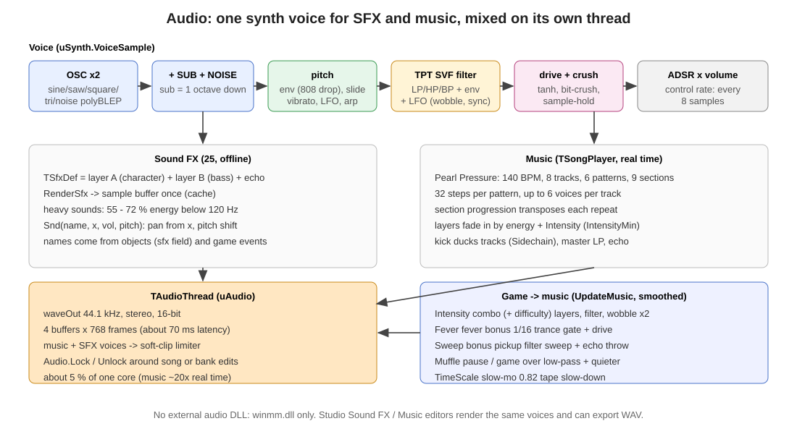

# 8. เสียงและเพลง

[← กลับสารบัญ](../DEVELOPER_GUIDE.md) · อ้างอิง: [ref_sound.md](ref_sound.md) · [ref_music.md](ref_music.md)

ที่มา: `src/usynth.pas` (770), `src/umusic.pas` (753), `src/uaudio.pas` (428)

## 8.1 Voice เดียวใช้ทั้งเสียงประกอบและเครื่องดนตรี (`TSynthParams`, 33 ค่า)

| ส่วน | พารามิเตอร์ |
|---|---|
| Oscillator | `wave` (Sine, Saw, Square, Triangle, Noise — polyBLEP), `detune` (ตัวที่สอง, cents), `subLevel` (sine ต่ำลงหนึ่ง octave), `noiseMix` |
| Pitch | `baseNote` (MIDI), `octave`, `pitchEnv` + `pitchDecay` (เสียงตกแบบ 808), `slide`, `vibDepth/Rate`, `arp` + `arpRate` |
| Filter | `filterType` (LP/HP/BP, TPT state-variable), `cutoff`, `resonance`, `filterEnv` + `filterDecay` |
| LFO | `lfoRate`, `lfoSync` (รอบต่อ beat), `lfoCutoff` (wobble), `lfoPitch`, `lfoAmp` (tremolo) |
| สี | `drive` (tanh), `crush` (bit), `downsample` (sample-hold) |
| Envelope | `attack`, `decay`, `sustain`, `release`, `duration` (SFX gate) |
| Mix | `volume`, `pan` |

pitch และ filter คำนวณทุก 8 sample (control rate) เพื่อความเร็ว

## 8.2 เสียงประกอบ (SFX)

- `TSfxDef` = ชั้น **A** (เอกลักษณ์ของเสียง) + ชั้น **B** (เบส, เปิดด้วย `useB`) + echo (`echoTime`, `echoFeedback`, `echoMix`) + `gain`
- `RenderSfx` สร้าง sample buffer ครั้งเดียวแล้วเก็บไว้ เล่นด้วย `Snd(name, x, vol, pitch)` ซึ่ง pan ตามตำแหน่ง x
- เสียงหนัก (hit, pulse, nova, …) มีพลังงานต่ำกว่า 120 Hz ประมาณ 55–72 %

**25 เสียง:** collect, collect_hi, prism, hit, pulse, shield, magnet, slowmo, double, life, star, fever, nova, levelup, complete, gameover, combo, block, menu_move, menu_select, pause, beam, charge, grate_fire, ready

ความยาว wave และค่าหลักของทุกเสียงอยู่ใน [ref_sound.md](ref_sound.md)

## 8.3 เพลง "Pearl Pressure"

| เรื่อง | ค่า |
|---|---|
| จังหวะ | 140 BPM, ยาว 5:01 นาที (วนซ้ำ) |
| Track | Kick, Clap, Hats, Sub Bass, Growl Bass, Pad, Arp, Lead (8 ช่อง, ช่องละ 6 voice) |
| Pattern | 6 pattern × 32 step (2 ห้อง 1/16) โน้ตต่อช่อง = `note:velocity(1–9):length` |
| Section | Intro, Build, Drop A, Break, Build 2, Drop B, Break 2, Drop A2, Outro — แต่ละ section มี pattern, จำนวนรอบ, progression (transpose ต่อรอบ เช่น `0 -4 3 -2`), energy |

## 8.4 เพลงตอบสนองเกม (`TWaveGame.UpdateMusic` → `TSongPlayer`)

| ค่า | มาจาก | ผลต่อเพลง |
|---|---|---|
| `Intensity` | เล่น: `0.85 × ความเข้มคอมโบ + 0.04 × ระดับด่าน`, pause: ครึ่งหนึ่ง, complete: 0.7, เมนู: 0.05 | เครื่องดนตรีค่อยๆ เข้ามาตาม `intensityMin`, filter เปิดตาม `intensityCutoff`, wobble ×2 (`intensityLfo`), sidechain ลึกขึ้น |
| `Fever` | effect Fever | trance gate 1/16 + drive + echo กว้าง |
| `Sweep` | เก็บโบนัส, คอมโบ x3/5/7/9, ยิง Grating | filter กวาดขึ้น + echo |
| `Muffle` | pause = 1, game over = 0.45 | low-pass + เบาลง |
| `TimeScale` | Slow-mo = 0.82 | เทปช้าลง (ทั้งจังหวะและ pitch) |

ทุกค่าถูกกรองให้นุ่ม (smoothing) ก่อนส่งให้เธรดเสียง

## 8.5 เธรดเสียง (`uAudio`)

- `winmm.dll` waveOut, 44.1 kHz, stereo, 16-bit
- 4 บัฟเฟอร์ × 768 เฟรม (latency ประมาณ 70 ms)
- mixer: เพลง + SFX ทุกตัว → soft-clip limiter
- แก้เพลงหรือ SFX bank ขณะเล่นต้องอยู่ใน `Audio.Lock / Unlock`
- ใช้ CPU ประมาณ 5 % ของหนึ่ง core (เพลง render ได้เร็วกว่าเวลาจริงประมาณ 20 เท่า)
- `MusicVolume`, `SfxVolume` จาก Options

## 8.6 ทดสอบ

`tools/audiotest.exe` render SFX ทุกเสียงและเพลงเป็น WAV พร้อมรายงานความดังและสัดส่วนเบส
