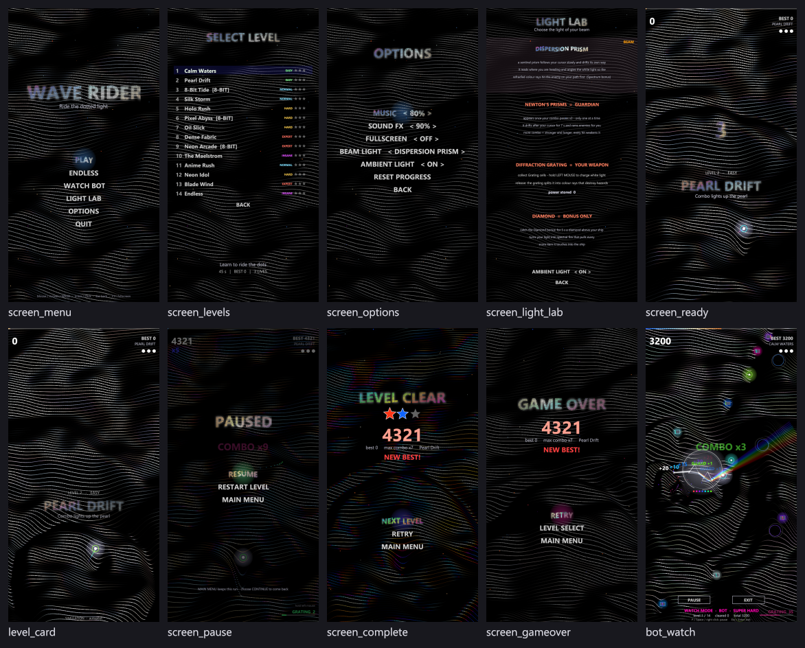

# 9. หน้าจอ เมนู และ UI

[← กลับสารบัญ](../DEVELOPER_GUIDE.md) · อ้างอิง: [ref_screens.md](ref_screens.md)

ที่มา: `src/ugame.pas` (`BuildMenu`, `MenuActivate`, `DrawMenu`, `DrawHudPlay`, `DrawLevelList`, `DrawLevelCard`), `src/ugfx.pas`, `src/ugameform.pas`

## 9.1 หน้าจอ 9 แบบ (`TScreenId`)

| id | section ใน screens.ini | ใช้กับ state | รายการเมนู |
|---|---|---|---|
| scMain | `[Main]` | gsMenu | (CONTINUE), PLAY, ENDLESS, WATCH BOT, LIGHT LAB, OPTIONS, QUIT |
| scLevels | `[Levels]` | gsLevels | รายการด่าน (ระดับ, ดาว, ล็อก), BACK |
| scOptions | `[Options]` | gsOptions | MUSIC, SOUND FX, FULLSCREEN, BEAM LIGHT, AMBIENT LIGHT, RESET PROGRESS, BACK |
| scPause | `[Pause]` | gsPaused | RESUME, RESTART LEVEL, MAIN MENU |
| scGameOver | `[GameOver]` | gsGameOver | RETRY, LEVEL SELECT, MAIN MENU |
| scComplete | `[Complete]` | gsComplete | NEXT LEVEL, RETRY, MAIN MENU |
| scHud | `[Hud]` | gsPlaying | คะแนน คอมโบ ชีวิต best ชื่อด่าน แถบเวลา พลัง Grating |
| scReady | `[Ready]` | gsReady | นับถอยหลัง + ป้ายชื่อด่าน |
| scLight | `[Light]` | gsLight | คำอธิบายแสง 4 แบบ, AMBIENT LIGHT, BACK |

แต่ละหน้าจอมี 35 ฟิลด์ (`TScreenFx`) ในกลุ่ม Title, Background, Menu, Light FX ดู [ref_screens.md](ref_screens.md)

## 9.2 ตัวอักษร Dotted Iridescent Pearl (`TDotText`)

1. วาดตัวอักษรเป็น mask ครั้งเดียวแล้ว sample เป็นกริดจุด (`dotSpacing`, `dotSize`, `dotRound`) — cache ไว้
2. ทุกเฟรมให้สีแต่ละจุดจาก palette มุก/รุ้ง (`palette`, `saturation`, `hueSpeed`, `hueScale`)
3. แถบประกายวิ่งผ่าน (`shimmer`, `shimmerSpeed`) และระยิบสุ่ม
4. จุดขยับขึ้นลงเป็นคลื่น (`dotWave`, `dotWaveFreq`, `dotWaveSpeed`)
5. แสงเรืองรอบตัวอักษร (`glow`) จาก `TGlowCache` (premultiplied blur กันขอบเทา)

ใช้กับชื่อเกม `WAVE RIDER`, หัวข้อทุกหน้า และรายการเมนูที่ถูกเลือก (`menuDotted`, `menuSelMode`)

## 9.3 HUD ระหว่างเล่น

| ตำแหน่ง | ข้อมูล |
|---|---|
| ขอบบนสุด | แถบเวลาด่าน (ไล่สีรุ้ง, เฉพาะด่านที่มีเวลา) |
| ซ้ายบน | คะแนน, คอมโบ `xN` |
| ขวาบน | `BEST n`, ชื่อด่าน, ชีวิต (จุด) |
| กลาง | popup คะแนน, banner, cut-in COMBO (≈35 %), ป้ายชื่อด่าน 1.2 วินาทีแรก |
| ขวาล่าง | `GRATING n` (+ `charge n` ขณะชาร์จ) และแถบพลัง, คำแนะนำ `hold left mouse` |
| ล่าง | `SIMULATION · autopilot` เมื่อจำลองใน Studio / headless |
| ล่าง (บอท) | แถบ WATCH MODE + ปุ่ม PAUSE / EXIT |

## 9.4 ป้ายชื่อด่าน (`DrawLevelCard`)

- วางที่ 55 % ของความสูงจอ บนแถบมืดโปร่งแสง (alpha 110 × ความทึบ)
- บรรทัดบน: `LEVEL n   -   DIFFICULTY` (ด่านไม่จำกัดเวลาแสดง `ENDLESS   -   INSANE`)
- บรรทัดกลาง: ชื่อด่านตัวพิมพ์ใหญ่ด้วยตัวอักษรจุดมุก (`TDotText` ใช้สไตล์ของหน้า Main) ขนาดปรับตามความยาวชื่อ
- บรรทัดล่าง: subtitle ของด่าน
- แสดงเต็มตลอด gsReady (ตัวเลขนับถอยหลังอยู่เหนือป้าย) แล้วจางหายใน 1.2 วินาทีแรกของการเล่น

## 9.5 การควบคุม

| อินพุต | เมนู | ระหว่างเล่น |
|---|---|---|
| เมาส์ชี้ | เลือกรายการ (cursor เป็นรูปมือ) | ยานตาม cursor (cursor ซ่อน) |
| คลิกซ้าย | ยืนยันรายการ / ลูกศร `< >` ปรับค่า | กดค้าง = ชาร์จ Grating |
| ↑ ↓ / W S | เลื่อนรายการ | บังคับยาน |
| ← → / A D | ปรับค่า (Options) | บังคับยาน |
| Enter | ยืนยัน | — |
| Esc / Backspace | ย้อนกลับ | Pause |
| P | — | Pause |
| Space | ยืนยัน | ชาร์จ Grating |
| F3 / F5 / F11 | แสดง fps / โหลด data ใหม่ / เต็มจอ | เหมือนกัน |

`CursorKind`: 0 = ซ่อน (กำลังเล่น), 1 = ลูกศร, 2 = มือ (ชี้รายการที่คลิกได้)
